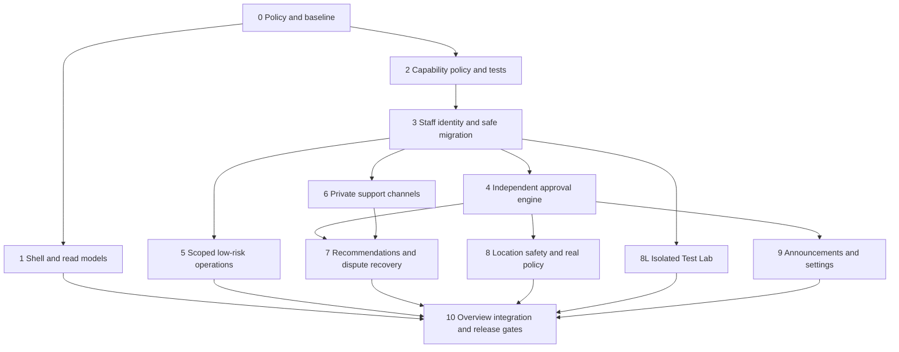

# Admin Control Center v1 — incremental implementation roadmap

Date: 24 October 2026 (Asia/Taipei). Planning only. No batch is authorization to implement it.
Baseline: `feature/temporary-local-meetup-testing` at local/remote `cf215e0bdda92d7874329f16102c2a9ebd20a1be`.

References: [Blueprint](ADMIN_CONTROL_CENTER_BLUEPRINT_V1.md), [gaps G01–G31](ADMIN_GAP_ANALYSIS.md), [permissions](ADMIN_PERMISSION_MATRIX.md).

## 1. Delivery principles and order

Implement small reviewed PRs, each with a concrete threat/permission contract and its own isolated tests. Do not combine role migration, private support messaging, geofencing and visual redesign into one change. Keep User/Booking/evidence IDs, old links, historical migration checksums and immutable audit/chat/meetup records. Do not alter participant rental behavior to make an Admin screen easier to build.

Suggested dependency order:

Layout/read-model work may proceed before new roles, but cannot expose unimplemented four-card metrics, change authority or use UI hiding as RBAC. Staff onboarding to limited roles waits for replacement of every legacy broad authorization path. Approval-backed actions wait for the approval engine; no temporary direct high-risk endpoint.

Complexity estimates use S 1–3, M 4–8, L 9–15, XL 16–25+ focused engineer-days per deliverable, including targeted tests. They overlap and are not a summed schedule. Separate security/product review and operations time are additional. Resource availability, policy decisions and discovered schema drift may change estimates.

## 2. Batches, acceptance and stop gates

### Batch 0 — policy contracts and reproducible baseline (S–M; G05/G09/G13/G19/G20/G22/G24/G27)

Deliver explicit low-risk booking allowlist; temporary user restriction duration/cumulative caps; station suspension effects on new bookings, current obligations and active proofs; serious-sanction criteria; notice risk/audience/emergency rules; support disclosure/retention and approver staffing roster. Define pending-handoff incident outcomes without inventing receipt. Confirm four Overview metric definitions and what viewers may count.

Source anchors: `lib/rental-lifecycle.ts::submitRentalStage`, `lib/admin/mutations.ts::resolveDispute/moderateUser`, `lib/meetup/service.ts::validChallenge/requireMeetupReceipt`, `lib/meetup/location.ts`, `lib/chat/moderation.ts::caseRecord`.

Gate: approved examples of permitted/forbidden actions and distinct-person conflicts; fresh-database baseline test manifest tied to SHA. Record the recovered camera failure and unresolved dependent advisory/operational risks. Stop if authority boundaries or human coverage are unresolved; do not encode guessed sanction durations as approved policy.

### Batch 1 — grouped responsive shell, route preservation and scoped read design (M; G01–G04/G26)

Reuse `app/admin/layout.tsx`, navigation/breadcrumbs, `components/admin/ui.tsx`, directories/details and current validators. Group the required sidebar; keep reports/disputes/chat deep links. Implement presentational/read-only changes separately from authority changes. Design per-role field projections and metric definitions before introducing new staff roles. Show only implemented destinations; do not ship dead links.

Gate: desktop/tablet/mobile, keyboard navigation/focus, overflow, selected group/breadcrumbs, old URLs, loading/error/empty states and unauthorized-page regressions. Compare queries/counts to fixtures; prevent private case details in Overview. Existing `tests/admin.integration.test.ts` and moderation/chat browser cases remain passing. No database migration required for a shell-only PR.

### Batch 2 — centralized fixed capability contracts and negative tests (L; G14/G15/G25)

Add a versioned action registry, explicit fixed-role mapping, resource scope predicates and field projections behind tested services. Inventory all legacy route/page/script/service gates. Initially test shadow evaluation against existing behavior without granting lower-privilege staff production access. Do not rely on a generic ADMIN OR new-role shortcut.

Scope: `lib/admin/auth.ts`, mutation actor checks, evidence route/service, `lib/chat/http.ts::chatApi`, `lib/chat/moderation.ts::reviewer`, server component calls, staff navigation, provisioning scripts, account/session projections.

Gate: matrix-generated tests for every role/action and anonymous/USER/revoked/suspended actors, direct endpoint and direct service invocation, case/participant conflicts and permission-shaped counts/DTOs. Unknown capability/action denies by default. A coverage checklist must account for every old entry point, not only the redesigned UI.

### Batch 3 — additive staff identity and authorization migration (XL; G14/G15/G25/G26)

Introduce reviewed StaffPerson/Membership/grant-history schema in a new forward migration. Retain legacy UserRole/ChatReviewer/AuthSession/AdminAuditLog. Bootstrap from a signed-off restricted roster with at least two independent qualified humans for high-risk authority; this matrix requires two independently eligible SAs for staff-grant changes and SA-authored requests. Explicitly map reviewer eligibility and scopes; preserve assigned case/evidence history. Add offboarding and audited reassignment.

Do not automatically promote existing ADMINs to SA or every reviewer to unrestricted MOD. Do not set ADMIN on Support/Operations accounts as an interim workaround. Replace all legacy bypasses before enabling limited-role onboarding; test compatibility with known legacy admins only within a bounded plan. Existing sessions must lose authority immediately on revocation. Add step-up human authentication for approvals before Batch 4 activation.

Gate: fresh and populated **owned test** upgrade fixtures; checksum/history preservation; explicit grant reconciliation; no broad fallback; last-capable-admin availability; same-person alias handling; mixed-version deployment/rollback tests. Rollback cannot reinstate blanket privileges for newly limited staff. No production identity/backfill procedure is executed without a separate approved plan and backup evidence.

### Batch 4 — independent approval engine and audit extension (XL; G27/G26)

Create immutable requests/decisions/execution records with action/resource/evidence/policy versions, canonical payload hash, expiry and idempotency. Separate propose/review/execute services. Require a different authorized human person, excluding investigators/recommenders/subjects/participants. Approval-capable SA cannot approve their own request. Enforce current grants and recent step-up at both approval and execution. Add append-only generalized audit references without modifying historical logs/triggers.

Gate: same user and same-person alias rejection; requester role change; revoked approver; expired approval; payload/audience changes; evidence/resource drift; policy change; duplicate/concurrent execution; audit failure rollback; transaction deadlocks; external outbox replay. Security-critical invariants reject even an otherwise valid two-human approval. A forged status/approval ID cannot mutate a domain. High-risk actions stay unavailable until this gate passes.

### Batch 5A — scoped listing/report and booking operations (M–L; G05–G07)

Adapt current listing restrict/restore/report services to capabilities and scope, preserving reason, version checks, owner inactivity and other effective restrictions. Add only the approved internal booking tags/follow-ups/alert acknowledgements. Keep booking state/price/station/custody fields outside direct operational payloads.

Gate: OPS permitted within scope, SUP/MOD/SA boundaries per matrix; restore cannot clear owner/report/suspension/media gates; duplicate/stale operation writes and mandatory audit; no actor impersonation or arbitrary status assignment through unknown fields. Test both old and new route URLs.

### Batch 5B — temporary user restrictions and serious-sanction proposals (L; G13)

Add expiring scoped restrictions, cumulative caps and explicit release events; serious/long-term sanctions use Batch 4. Keep ordinary return/inspection/dispute/private support access. Define effective restriction calculation rather than replacing AccountStatus in ways that erase existing sanctions. Use a safe expiry mechanism with idempotent work and current-policy checks; preserve all restriction history.

Gate: overlapping restrictions; expiry does not remove another sanction; repeated short restrictions cannot bypass cap/review; no self/participant conflicts; serious sanction requires independent human; account/booking mutation races; delayed expiry worker and operator alerts.

### Batch 6A — tickets and separate private support channels (XL; G16/G17)

Implement SupportTicket lifecycle/assignment and independent Owner/Support vs Borrower/Support channels. Link existing reports/disputes/coordination records by reference, never move or rewrite original chats. Keep support entry available when free-text marketplace chat is blocked/disabled. Support queue metadata must not expose conversation bodies. Add purpose-bound private evidence/attachment permissions and sanitized uploads; explicit internal notes have no participant endpoint.

Gate: complete actor/channel ACL matrix, ID guessing and cross-ticket/channel attacks; duplicated tickets and participant reassignment cannot expand access; inactive/blocked parties can still fulfill support obligations; immutable message attribution; audited private-byte release; read/unread/ordering/retries; bounded bodies/rate limits and sanitized file types; desktop/mobile browser tests. Staff account settings cannot grant channel membership.

### Batch 6B — controlled mediation and case handover (L; G18/G15)

Add deliberate redacted sharing with explicit recipient channel, purpose/basis, source refs and disclosure ledger; sensitive disclosure uses approval. Add staff reassignment/offboarding with scoped access revocation, preserving independent appeals. Never auto-forward the opposite party's messages or attach an unrestricted marketplace conversation.

Gate: source access alone does not permit disclosure; consent/policy basis drift invalidates proposal; internal-only notes/third-party data stay hidden; reassign/revoke takes immediate effect; disclosure/outbox retries do not send twice or change audience. Complete a manual privacy review before enabling.

### Batch 7 — dispute recommendations and pending-custody recovery (L–XL; G19/G20)

Split current `resolveDispute` into investigation/recommendation and approval-backed execution. Replace the old direct resolve route's authority too; no legacy shortcut remains. Reuse transactional evidence and legal outcome checks. Implement new pending-handoff incident policy only after Batch 0 approval, preserving facts and clearly distinguishing administrative findings from participant confirmations. Link tickets and both private channels without merging them.

Gate: support investigator cannot approve; independent authorized person required; version/evidence changes invalidate approval; no fabricated Handoff/Return/checklist/verified location; ADMIN_CLOSED remains distinct from COMPLETED/review eligibility; disputed-state races; failed digital confirmation after a real exchange; withdrawn/uncooperative participant; private support content not exposed in participant-visible decision. No payment handling or settlement actions.

### Batch 8A — station catalogue and safety overlay (L; G08/G09)

Add Admin read-only catalogue/detail first, then separate safety suspension/history keyed by canonical station. Implement immediate OPS suspension and independently approved restoration. Ensure source re-import cannot restore a safety-suspended station. Integrate eligibility in map/selectors, quote/request/acceptance and QR supporting signals. Existing booked station identity stays unchanged; surface assistance rather than silently relocating.

Gate: unknown/missing/nonoperational stations; import plus suspension races; suspension vs accept/issue/scan; restoration by the same person rejected; immutable source/hash/history; old booking references preserved; unsafe station cannot regain verification due to timeout or generic setting change. Approved assistance must preserve physical obligation and never fabricate location proof.

### Batch 8B — sensitive geofence policy versions (L; G10)

Introduce bounded approved policy versions with provenance, independent authorization and consistent effective version in challenge evidence. No editing the official JSON catalogue in the dashboard. Define safe invalidation/reissue for active proofs and how history displays the original policy. Missing authoritative coordinates remain unavailable; no radius override can create them.

Gate: source/range/calibration validation; distance-plus-accuracy and freshness unchanged; no disabling policy through settings; policy-version drift invalidates approvals; challenges cannot outlive prohibited policy use; independent approver and audit; rollback creates a new approved version rather than overwriting evidence.

### Batch 8L — isolated Test Lab, independently deployable only as developer tooling (M–L; G11/G12)

Reuse existing owned-test-database runtime and booking consent. Harden effective PostgreSQL host validation, not just URL.hostname. Add explicit map-selected simulated center alongside on-demand device center; map geometry must yield valid geodetic coordinates, not reinterpret schematic SVG units. Add narrow staff-lab scope without allowing staff to acknowledge on behalf of demo participants. No production/lab data connector or center persistence.

Gate: production/shared/retained DB denial; marker/allowlist/name mismatch; connection query overrides rejected before connecting; current-GPS and map-source labels; no scripted participant GPS substituted as real samples; independent simulation consent; unchanged distance/accuracy/freshness/checklist/QR/custody checks; one-hour expiry/revoke/restart/generation mismatch; coordinate absence in logs/URLs/DB/audit; cleanup only owned resources. Resolve repeatable fake-camera browser coverage and record separate Android/iOS/desktop physical-device results. Lab must remain absent/inoperable in production regardless of SA/settings.

### Batch 9A — announcements, then 9B — typed settings (M–L each; G21–G24)

Announcements: implement draft/immutable revisions and routine publication first, with no high-impact publish until Batch 4. Then approval-bound high-impact content/audience/schedule, outbox retries, withdrawal/correction history and expedited dual-human emergency templates. Do not imply email/SMS/push delivery exists unless a later provider/infrastructure scope is approved.

Settings: implement code-defined schema/risk/scope/bounds and read model, then allowed low-risk writes, then approval-backed high-risk changes. No arbitrary env/secret/SQL editor. Security invariants are not settings keys. Changes need effective versions/cache invalidation and dependency invalidation, not immediate silent global mutation.

Gate: routine content cannot masquerade as high-impact via batching/audience expansion; XSS/link abuse, schedules/timezones, expired approval, audience change, duplicate delivery and revoke races. Unknown/high-risk settings rejected on low-risk endpoint; parameter bounds/risk downgrade attempts, policy cache invalidation, concurrent writers, denied invariant changes and audit failure. Emergency with only one authorized human must remain blocked for high-risk publication.

### Batch 10 — final Overview integration, security review and operational acceptance (L; G02/G03/G25/G26)

Wire the four agreed metrics and Requires Attention to actual shipped models and role filters. Add redacted administrative platform activity and links that reproduce counts. Integrate staff access review/approval queues, monitor stranded cases/pending actions, and document incident response. Keep denied/failed action security events distinct from committed success events.

Gate: full capability/action/field projection regression; high-risk independence and human-alias tests; all existing Admin/chat/rental/MRT suites; concurrent actions and upgrade-history fixtures; desktop/mobile/accessibility; temporary-lab isolation; private data never in global feeds/logs. Rehearse approvals with actual independent human staff, not two accounts operated by one founder. Resolve applicable dependency advisories and verify durable DB/file/private-evidence restore, trusted ingress throttling, MFA/step-up and operator coverage before real-user/property pilot. No automated merge/deploy.

### Future batch — AI service agents (Future/deferred; G29/G30)

No autonomous Admin execution in Blueprint v1 implementation batches. A later proposal may introduce service principals for narrow read/draft tasks, explicit scoped/time-bound grants, untrusted-input isolation, separate audit actor and human approval. Reuse advisory shadow-analysis validation without giving it staff identity. Never count AI as an independent approver, permit self-grants, share human credentials or bypass custody/audit/test isolation. Payments and unrelated marketplace service categories remain separately deferred.

## 3. Common test and migration contract

- Baseline commands: lint, TypeScript, unit, Admin, moderation, chat, rental API/browser, stability, meetup, meetup-migration, MRT/admin migration, isolated integration/build and MVP security checks. Add new role/approval/support/location suites without weakening existing assertions to pass a new screen.
- Database-changing tests run only through a reviewed ownership-safe isolated runner on a fresh non-existing `hustlen_test_*` database. No test may adopt/reset/seed/migrate an existing development or retained demo database. Validate effective driver connection parameters as well as parsed URL/name; enforce actual DB identity and exact run ownership marker.
- Create populated prior-version fixtures **inside those fresh owned test databases** to test upgrades. Preserve counts, actor attribution, station FK values and original migration checksums. No historical migration edits or automatic rebaselining.
- Capture commit SHA, exact command/tool versions, pass/fail/skip counts, owned-run artifact path, cleanup outcome and test target identity without secret values. Prior passing reports do not validate a new batch. A flaky camera/assertion failure remains reported until diagnosed, not reclassified as success because API tests pass.
- Gate all endpoints, services and server component data reads; check fresh persisted permissions. Audit-read failure cannot release evidence bytes; audit-write failure cannot commit authority changes.
- Retain old URLs and privacy boundaries. Do not automatically migrate marketplace conversations into support channels, public evidence into private exports, or test coordinates into real station policy.

## 4. Rollout, rollback and small-team constraints

Use additive schema and independently reviewed explicit backfill plans; preserve records and demonstrate recoverability before any approved deployment. Feature gates can keep incomplete UI/actions unavailable, but cannot disable server protections. A mixed old/new application deployment must not let old broad endpoints remain reachable to newly limited staff; test or avoid the mixed window. Rollback disables new actions/grants first and never restores blanket ADMIN access to lower-privilege accounts. Immutable decisions/evidence remain visible; compensating decisions are new events, not log rewrites.

Do not authorize high-risk go-live before staff-person binding, step-up authentication, independent approver coverage and audit/execution gates exist. A one-person team can operate allowed low-risk and immediate deny-only safety actions; it cannot resolve its own high-risk requests. A two-person team may need a third eligible reviewer for appeals. Staff absence queues work, not a bypass. Emergency procedures retain this limitation and must state the resulting operational SLA.

## 5. Approval boundary for next work

Recommended first coding scope, **after separate approval**, is Batch 0 policy resolution plus a small Batch 1 presentation-only PR, followed by Batch 2 capability tests. Do not launch the entire roadmap at once. Authorization/private-support/approval model migration plans need their own review before schema/application changes.

This task ends with four documents. No permissions, AI agents, payment code, Admin screens, database changes, migration edits, merge or deployment were implemented or authorized here.
