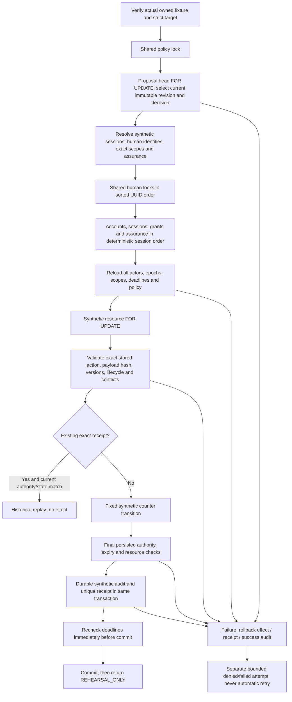

# Approval execution safety contracts — Batch 4B

24 October 2026 (Asia/Taipei). **Non-activating. No real Admin executor, endpoint, activation switch or production handler is implemented.**

## Two deliberately separate layers

[execution-contracts.ts](../../lib/authorization/approvals/execution-contracts.ts) is a server-only, descriptive registry for eight proposed action families: serious sanctions/reinstatement, station restoration, geofencing policy replacement, high-impact notices, staff permissions, dispute resolutions and custody incident review. Each frozen contract supplies canonical request/approval identifiers, a **proposed/unregistered** execution capability, domain, schema version, permitted reference-intent transitions, expected legal state, lock order, independent-human/conflict requirements, version checks, atomic audit/receipt, idempotency and stale/failure rules. Unknown actions return null. Every known contract returns blocked readiness; no entry contains a callable handler.

The closed payload validator accepts only kind, exact resource identity, whitelisted transition, immutable change reference/digest and reason reference. Extra SQL, model names, arbitrary status fields, raw coordinates or message bodies are rejected. Hashing validates first, sorts the fixed primitive fields, and binds the schema version and canonical request action. This is reference-level validation, not verification of the external content or a product-approved domain mutation. Production payload/evidence providers and action-specific business validation remain prerequisites. The proposed `.execute` identifiers are not added to the existing capability/grant registry.

The actual rehearsal lives only in [tests/support/execution-rehearsal.ts](../../tests/support/execution-rehearsal.ts), with checked-in [test SQL](../../tests/fixtures/approval-execution.sql). It is not an application executor. It implements exactly one action, `synthetic.counter.advance`, over the separate `approval_rehearsal` schema: READY/value=0/version=N → CONSUMED/value=1/version=N+1. It never dispatches through the real action registry. The execution call takes a credential and proposal UUID, **not** an action, handler, SQL, model, desired status, approval JSON or effect callback.

There is no new Prisma model or application migration. The installer first verifies NODE_ENV is not production and checks the existing strict local `hustlen_test_*` URL, actual current database ownership marker and runner identity. It then reads one fixed checked-in SQL file, using a separately ownership-verified test connection. Execution rechecks both database ownership and its installation run ID inside every transaction. The SQL file is outside Prisma migration discovery. A flag or pending staff row cannot enable this path.

## Synthetic trust and immutable history

All principals, accounts, sessions, grants, attestations, resources, proposals, decisions, receipts and audit events live in `approval_rehearsal`. No Users, AuthSessions, StaffPersons, StaffMemberships, Bookings, Disputes, MRT stations, real evidence or payments are created or mutated by the rehearsal. Synthetic session tokens are hashed; they are not real staff cookies. No DRAFT membership, pending staff step-up or shadow MATCH is consulted. A fixture attestation must be current TEST_VERIFIED, match the exact persisted synthetic session/canonical human/epoch and not be revoked; PENDING is rejected. These attestations are deliberately test-issued, not a real MFA verifier.

Aliases map to the same canonical synthetic human. The fixture conservatively requires **three** distinct humans for requester, approver and executor. This tests separation without approving a production executor-role allocation or third-human requirement. Every actor needs a current exact resource/action grant. The resource's conflict set represents the canonical union of participant, target, investigator, recommender and prior-reviewer exclusions; real case/incident lineage construction is not implemented. All three actors are excluded if present in that set.

Payloads, revisions, decisions, receipts and audit events reject UPDATE/DELETE. Proposal identity/action/deadline is immutable; only advancement to an existing new revision is permitted. A decision references the exact revision/hash, and a receipt references that decision and revision/hash. Only one receipt exists per proposal/revision and per decision. Audit is a required receipt FK. Receipt before/after checks constrain the only legal effect to one increment/version advance. Synthetic seed helpers can deliberately construct expired or semantically forged hypotheses for negative tests; execution independently revalidates them instead of trusting a stored ruling.

`authorized:false` always refers to real production authority. `executed:true` means only that the synthetic counter committed. Repeated execution returns `executed:false,replayed:true` with the existing receipt after current authority and exact resulting resource state are checked. Drift, expired authority or revocation denies rather than silently returning fresh eligibility or repeating the effect.

## Transaction and lock order

Isolation is **READ COMMITTED**; consistent relational locks, immutable rows and repeated authoritative reads are required. No cached or browser-supplied permissions/versions are trusted.

Policy/head locks serialize concurrent attempts on a revision. Shared actor/session/grant/assurance locks prevent cooperating revokers from committing changes during the validated effect; the resource lock protects its versions/state/conflicts. Authority is reloaded after locks and after the provisional effect, and expiry is checked again after audit/receipt insertion. The payload is rehashed and its closed schema/resource/version binding revalidated from persisted bytes.

Revocation committed before actor locks is observed and denies. Revocation started while actor locks are held waits; the already validated execution commits before revocation, and subsequent execution/replay attempts deny. This is a stated linearization, not a promise to retract committed/delivered information. Time expiry is evaluated at authoritative checks, not a guarantee about network-delivery time or an infinitely precise wall-clock boundary during WAL commit.

Writers must follow compatible lock ordering and couple permission changes to authoritative epochs/session invalidation. The rehearsal tests explicit human-epoch revocation and current grant/session flags. It does **not** implement a production provisioning/revocation writer protocol. A deliberately reversed-order peer creates a real PostgreSQL deadlock; `40P01` aborts the attempt. A held resource produces real `55P03` lock timeout. Neither path retries or leaves an effect/receipt. Global existing staff/domain writer ordering, lock upgrades, offboarding and external store consistency still need independent review before integration.

Audit failure rolls back a provisional domain effect. Domain failure cannot leave a success receipt or success audit. Failed/denied attempts use separate transactions and bounded metadata; if audit storage or ownership checks prevent that record, a bounded operational diagnostic is emitted and execution remains denied. No token, raw exception message, payload body, GPS, private evidence or identity document is placed in receipts/audits. Real security-event COMMITTED safeguards are untouched; REHEARSAL_COMMITTED is only a label in the test schema.

## Limits of the demonstration

- The registry is descriptive and blocked; the test executor is not installed in production or linked to legacy services.
- The fixture proves database behavior for this fixed synthetic domain, not all real domain state transitions or cryptographic human/MFA proof.
- DB owners/superusers can alter tables/triggers or fabricate test records. Ordinary append-only DML protections do not provide owner-resistant audit provenance. No runtime/migration/audit credential changes were made.
- Original runtime sessions, grants, case/participant lineage, immutable external payload/evidence providers and independently protected audit writers are not integrated.
- Ambiguous commit/network loss needs protected receipt reconciliation and an explicit response protocol. There is no automatic retry; an explicit repeat may return historical receipt metadata only if current scope/state remain valid.
- Exactly-once database effect is not a claim of distributed exactly-once messaging, production readiness or approval protection for existing legacy actions.
