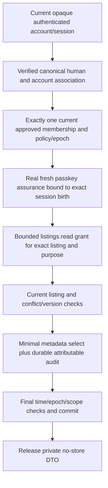

# First bounded staff read cutover plan — Batch 5C

24 October 2026 (Asia/Taipei). Planning only. No staff capability/role/session issuer activated; no unrestricted Admin helper moved to a lower role.

## Selected candidate

Propose **listings.read for one exact listing's operational metadata**. Suggested first cohort is approved Operations Staff, but the registry currently marks this read's role allocation proposed, not product-approved. Obtain explicit allocation/cohort/scope sign-off first. Do not silently grant all four roles or legacy ADMIN the new context.

Reuse the projection pattern in `lib/authorization/scoped/reads.ts::reads["listings.read"]`: only `{id,status,category,adminRestricted}`. No owner identity/contact, participants, rental history, chats, media path/URL/bytes, condition evidence, disputes or bulk counts. A listing restriction flag is internal operational metadata, so exact purpose/scope remains required even if some other fields are public. No update, status edit, location simulation or export is included.

## Inventory reviewed and preserved

The complete historical inventory is `docs/admin/LEGACY_ADMIN_AUTHORIZATION_INVENTORY.md`, with all 21 hashed Admin API entries in `LEGACY_ADMIN_ENTRYPOINTS_BATCH_2B.json`. Batch 5C's [current inventory snapshot](../security/batch5c/admin-entrypoints.json) additionally records every current Admin page/API, relevant services/components/CLI/participant boundaries and the separate Batch 5B `/api/auth/admin-passkeys` endpoint. Those legacy API/auth/service hashes remain unchanged; passkeys remain development-only and their own current ACTIVE ADMIN + verified association boundary is preserved.

Review categories include Overview/directory/detail reads, booking/user/listing Admin data helpers, reports/disputes mutations, private dispute evidence transport, ChatReviewer queue/assignment/evidence/decisions, participant chat and media authorization, server components/layouts, provisioning/import/seed/demo/reviewer/analysis CLIs and proxy/media rewriting. A hidden link or client component is not authorization. Out-of-band database scripts are not staff permissions. No CLI is reused for human onboarding or first-read execution.

## Exact future implementation boundary

Plan a new separately guarded route such as `GET /api/staff/listings/[id]/metadata` and a minimal staff page outside the legacy `/admin` layout. The path is a **proposal, not implemented**. Do not add staff-role fallback to existing `/api/admin/listings/[id]`, `adminApi`, `requireAdminPage` or `lib/admin/data.ts`; their broader DTOs/current ADMIN authority are inappropriate for lower roles.

The server obtains only the authenticated cookie/session credential and bounded listing identifier from transport. Resolve the canonical verified person/association, exactly one eligible ACTIVE fixed-role membership, valid-from/expiry, explicit RESOURCE listing grant with OPERATIONS_METADATA purpose, unchanged policy and lossless bigint authorization epoch. Reject suspended/revoked identity, session ID reuse, revoked/expired key, stale MFA version/config, DRAFT/PENDING records and unknown capabilities. The actual assurance must be issued by the isolated verifier, not a body MFA flag, pending step-up or arbitrary proof reference.

Select an exact server-owned read contract and recheck resource identity/version, assignment if required by the approved grant, conflicts and field classification. Role names alone never bypass a resource check. Return neither existence nor private metadata for an unauthorized listing. No caller-specified SQL fields/filters, bulk IDs, action/risk/policy/person/role mappings or evidence escalation.

## Reuse limits discovered

`createScopedShadowReads` is not production authorization. Its policy snapshots/fence are trusted synthetic dependencies; a shadow MATCH grants nothing. It invokes its audit callback only for evidence-classified contracts. **listings.read currently has no required metadata audit**, so routing it unchanged would fail the requested durable chain. The production path must unconditionally commit an attributable bounded access event for this first staff read, even though it contains no private evidence.

The existing outside-transaction boolean fence also leaves a release/revocation integration gap. Define consistent identity/grant/resource lock ordering with all revocation writers, exact expiry checks and an audited commit-before-release boundary. State semantics honestly: a read authorized at committed release may serialize before a later revocation; a delivered response cannot be recalled. Test revocation before locking, while waiting, during the transaction and immediately afterward. Do not claim a fixture fence is global real-time revocation enforcement.

Current constraints forbid ACTIVE memberships/grants, COMMITTED staff security results and active approvals. They must **remain** until a separately reviewed additive cutover migration and complete real issuer/scoped boundary are ready. That future migration needs exact policy/version compatibility and old-session behavior, fresh/populated replay/failure tests, no auto-promotion and a reviewed rollback. Do not bypass constraints with session settings, trigger disabling, owner SQL or a runtime activation flag.

## Small future batches and testing gates

| Future batch | Concrete change | Mandatory tests / stop gate |
| --- | --- | --- |
| Policy decisions | Approve first role/cohort, listing-field classification, exact grant purpose/expiry, identity/recovery and reviewer capacity | Decision record; absence blocks activation. |
| Trusted component boundary | Isolated verifier credentials/process and authenticated scoped/audit transaction design | Runtime cannot forge assurances/audits or inherit writer; actual signed proofs, current-session binding, principal failure/rotation and no owner grants. |
| Typed real staff context | Current canonical human/member/grant/assurance/epoch resolver, still unable to issue until reviewed cutover | Anonymous/ordinary USER/legacy ADMIN alone deny; each role, aliases, DRAFT/PENDING, expired/suspended/revoked identities and lossless bigint versions; no staff label on legacy endpoints. |
| One metadata adapter + durable audit | Exact listing projection and authoritative same-transaction audit, fail closed | Wrong/unassigned listing, grant purpose/policy/resource drift, conflicts, forged action/fields, audit failure, expiry/lock contention/revocation; zero unexpected rows/fields/bytes, no read release before audit. |
| Reviewed activation composition | Exact additive policy/schema activation change only after complete issuer/read path; bounded voluntary cohort | Fresh/populated migration preservation, old-client compatibility, negative legacy endpoint access, no broad ADMIN fallback; independent security review. |
| Operational pilot | Minimal separate staff page, privacy cache/error controls, revocation/onboarding/offboarding drill | Real device/session use, browser/API/service/DB negative coverage; deployment and rollback rehearsal, no mutations/approval execution. |

Verify every boundary independently at HTTP, direct service and database level. Include an ordinary USER carrying a future role label, revoked grant, same-human alias, participant conflict, wrong resource/case scope, spoofed MFA flags, wrong origin, expired/reused session, arbitrary assurance UUID, audit outage and schema permission attempts. Deny must leave no sensitive read response and no success audit. Preserve all Admin/moderation/chat/rental/QR/GPS/evidence regression behavior. No tests or production accounts for a lower role may use legacy ADMIN as a workaround.
