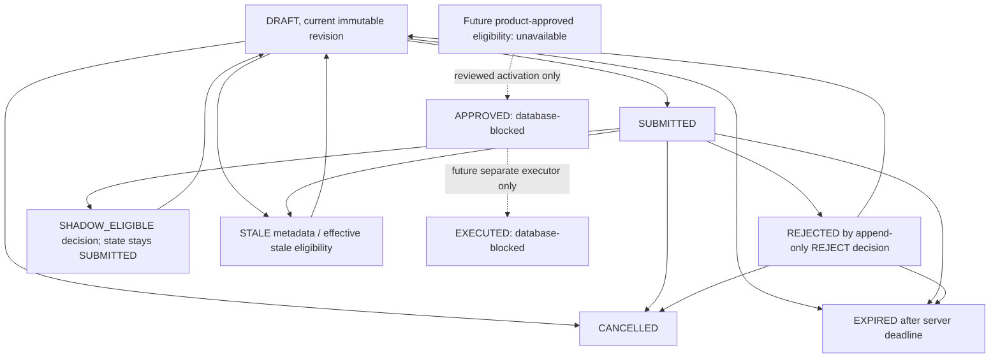

# Independent approval foundation — architecture and lifecycle

24 October 2026 (Asia/Taipei). **Inactive foundation only. Every production approval policy is denied. No executor or execution-receipt writer exists.**

Sources: [schema](../../prisma/schema.prisma), [migration](../../prisma/migrations/20261024160000_independent_approval_foundation/migration.sql), [candidate evaluator](../../lib/authorization/approvals/candidate.ts), [isolated service](../../lib/authorization/approvals/service.ts). The version `hustlen-approval-foundation-v1` identifies this reference-manifest protocol, not product approval.

## Persistence and exact-change binding

| Model | Immutable contract |
| --- | --- |
| StaffChangeRequest | Stable UUID, person/account derived from a persisted pending binding, canonical request/approval action pair, server-catalog HIGH risk/resource kind, person-scoped idempotency UUID and server-generated correlation UUID. Only state/currentRevision can change. No request can be APPROVED or EXECUTED. |
| StaffChangeRevision | Append-only `(requestId, revision)` and unique `(requestId, revision, payloadHash)`. Exact target/audience, resource/evidence/policy/approval-policy/requester-epoch versions, payload reference **and content digest**, canonical manifest/hash, reason reference/code, 1–16 evidence references, creation and bounded expiry. |
| StaffApprovalDecision | Append-only exact request/revision/hash FK, reviewer binding/person/account/epoch, ruling, rationale reference/code, timestamp and globally unique idempotency UUID. At most one decision per request/revision. APPROVE is forbidden. Self/alias decisions are rejected by canonical person. |
| StaffChangeTransition | Trigger-maintained append-only state/revision history and DB actor. Direct insertion, updates/deletes and populated truncation are rejected. It records database provenance, not independently verified human MFA. |

All new tables have restrictive FKs to new staff/proposal history only. Existing AuthSession, UserRole, ChatReviewer, booking, evidence and AdminAuditLog fields are unchanged. SessionBinding gains inverse Prisma relations only. No migration seeds staff, proposals, decisions, grants, policies or history.

The manifest is a **closed reference-only object**, not arbitrary operational JSON, SQL or a general Booking status editor. It binds action, kind/target, audience, decimal-string bigint versions, exact payload UUID/content digest, reason/evidence references, expiry, revision and fixed intent. The service resolves resource versions and payload content digest through a server-installed provider. It canonicalizes via PostgreSQL `jsonb::text`, hashes UTF-8 bytes with SHA-256, and stores the exact canonical string. SQL independently verifies the digest, canonical representation and equality to the typed revision/header fields. Extra keys, mismatched fields, payload substitution and hash forgery fail. Bigints never pass through unsafe JS-number conversion.

The fixture payload provider seals actual harmless reference-only content in an immutable **test-owned** table, with a digest CHECK. It is not a production secure object store or an approved action-payload validator. Before live use, per-action validated payload schemas, immutable protected blob versions, reason/rationale/evidence stores, access grants and retention must be implemented. UUID syntax alone is not proof that a protected object exists. The production path stays blocked while those providers are absent. No private message, evidence byte, raw GPS, password, token or identity-proof document is stored in approval/global transition records.

## Lifecycle



New revisions reset the head to DRAFT atomically, retaining every old decision and transition. Rejection/staleness can be followed by a new immutable revision; cancellation and expiry are terminal. Changes to target, audience, payload or evidence must produce a new revision/hash. An action-family change requires a new request. Policy versions are fixed in this inactive migration; a future policy upgrade needs reviewed migration/invalidations, never a client flag. Drift in resource/evidence/policy/content versions immediately denies eligibility even if the stored head still says SUBMITTED. There is no production staleness/expiry worker; SQL supports conservative metadata transitions, with EXPIRED requiring the actual deadline. No generic state-editing service is exported.

A SHADOW_ELIGIBLE decision is neither a state transition to APPROVED nor a bearer permit. Old decisions cannot attach to another revision/hash, and the current head must match. Idempotent decision replay returns `hypotheticalMatch:false`, `HISTORICAL_DECISION_NOT_ELIGIBILITY`, not fresh eligibility. Exact REJECT retries can return the existing decision without reopening the rejected request.

Proposal expiry is capped by the pending actor's validity and a one-hour engineering ceiling. This is not a product-approved approval TTL. Refreshing a changed original binding/policy requires a separately reviewed supersession/new-request design; this batch does not silently rewrite requester provenance.

## Trusted flow and independent-human matrix

```mermaid
sequenceDiagram
  participant S as Server / isolated fixture
  participant A as Persisted session and pending actor resolver
  participant D as Owned PostgreSQL transaction
  participant P as Trusted fixture domain/assurance provider
  S->>D: Verify actual disposable database ownership marker
  S->>A: Existing session credential, never caller roles
  A->>D: Resolve account, canonical human, binding, epoch and exact grants; lock actor rows
  Note over A,D: Pending attribution is not live MFA or staff authority
  S->>D: Lock request head and select exact immutable revision/hash
  S->>P: Resolve real fixture resource/content versions, assignments and assurance
  S->>S: Check distinct human, capability, scope, versions, recency and conflicts
  S->>D: Insert hypothetical decision and required bounded audit
  S->>A: Reload current pending actor
  S->>P: Recheck current facts after audit
  S->>D: Commit only if final checks pass
  S-->>S: authorized=false, readyForActivation=false
```

`resolvePendingFoundationActor` is an attribution-only addition to Batch 3C. It returns no permit. Optional shared locking follows the existing session/grant/membership/person protocol. The existing Batch 3C behavior defaults to its original exact-grant locking. Both the new service **and** candidate inspector require the actual strict local owned-database marker; NODE_ENV=production refuses. No route, Server Action or Admin component imports the new modules.

| Condition | Live policy | Isolated hypothesis requirement |
| --- | --- | --- |
| Human identity | No live issuer/policy; denied | Persisted verified canonical person and account/session/binding; alias accounts share one person |
| Fixed role | All four roles inactive | Actual DB role AND proposed contract eligibility AND explicit fixture specification; none alone suffices |
| Approval capability | No product-approved allocation; denied for every family | Exact canonical `.approve` action/grant, resource, scope/case, epoch/policy and validity |
| MFA | Pending markers never qualify | Separate `VERIFIED_FIXTURE` assurance from an owned test table, matching person/account/binding/version; recency ≤5 minutes. This is not a live MFA issuer. |
| Independence | Unavailable for production | Not requester, participant, subject, investigator, recommender or prior reviewer, including canonical aliases |
| Prior revision reviewers | Product taxonomy still needs approval | Conservatively exclude all earlier-revision reviewers on this request, plus domain/appeal lineage supplied by provider |
| Proposal | No execution eligibility | Current submitted revision, unchanged hash/content/target/audience, matching resource/evidence/policy, unexpired; requester still eligible |
| Assignment/privacy | No production domain adapters | Exact assigned case/resource; no private-channel implication and no global Super Admin scope |
| Audit | No production protected writer | Required bounded audit in the same transaction; failure rolls back decision/history |

Frozen Batch 2B role allocations remain **proposed**. Synthetic approval hypotheses use an explicit fixture-only SA allocation to exercise conditions. Operations, Support and Moderator do not receive universal approval powers. Even a valid synthetic match is always `authorized:false`. `productionApprovalReadiness` denies every action, including serious sanctions, station restoration/geofencing, staff permissions, high-impact notices and high-risk dispute outcomes.

## Transactions, concurrency and limitations

Request creation uses a transaction advisory lock on canonical-person/idempotency key, backed by a unique index; aliases cannot create duplicates with that key. A hash collision can only over-serialize, not confer authority. Same-key/different-content retries deny. Decision writes lock the request head; unique constraints prevent duplicate/conflicting decisions and exact FKs prevent stale-revision/hash rebinding. Concurrent revisions use expected-revision checks. Revisions, head advancement, transitions, decisions and required fixture audit commit or roll back together. Audit-time DB drift is re-resolved before return.

Tests use real PostgreSQL connections and immutable persisted fixture records, not in-memory boolean authorization alone. Resource/assurance providers use shared row locks. This is not a globally proven production lock protocol: original-requester eligibility, all future writers, resource lineage, external blob verification, caches, deadlocks and transport/revocation races need independent design/load review. Any timeout/deadlock/failure must deny. No operational callback or executor is exported.

Triggers are ordinary INVOKER functions with fixed search paths, not SECURITY DEFINER shortcuts. Append-only DML protections and PUBLIC revocations do not defeat a DB owner/superuser altering constraints/triggers or forging structurally matching metadata. Human attestation and independently protected runtime/migration/audit writer privileges remain blockers. Transition databaseActor is not an authenticated human claim. No production credentials or infrastructure were changed.

## Separate future execution receipt

No receipt table or writer is added because execution is unauthorized. A future design should separately bind receipt UUID, request/revision/decision, canonical payload hash, exact target/audience, resource/evidence/policy versions, requester/reviewer/executor authorization and attestation references, idempotent effect identifier, before/after versions, result digest, immutable audit reference and commit timestamp. One successful receipt/effect per exact approved change must commit atomically with a whitelisted domain operation. Reservations and failed/denied attempts are separate records, never authority. SHADOW_ELIGIBLE and existing shadow MATCH cannot authorize a receipt. Every executor must retain existing custody, receipt, QR/GPS, checklist, dispute and evidence invariants; no arbitrary SQL/status callback is permitted.
