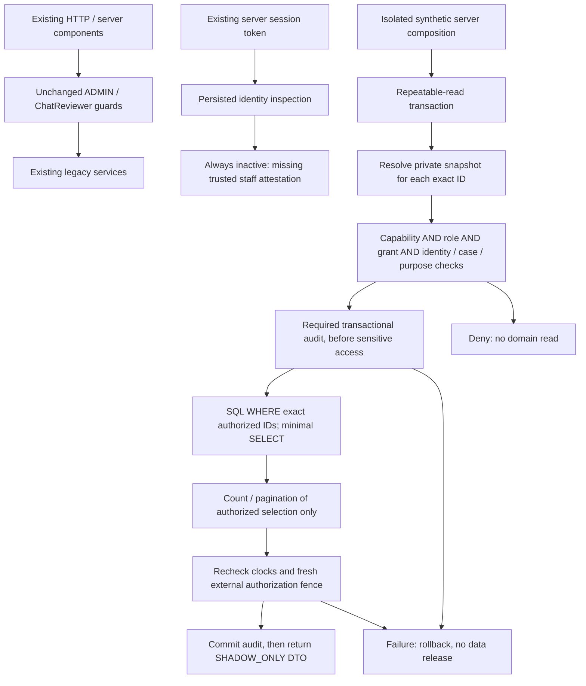

# Scoped Data Access architecture — Batch 3B

24 October 2026 (Asia/Taipei). Non-activating parallel implementation. No production authority cutover.

## Trust boundary and implemented flow

[identity.ts](../../lib/authorization/scoped/identity.ts)::`inspectPersistedStaffIdentity` hashes the existing session token server-side and queries AuthSession, current account status, permanent account/person association, verified human, persisted bigint epoch/policy and current membership. It never accepts a role, human proof, grant or risk from a browser. Its result is **always** `authorized:false`, including if an incorrectly relaxed database supplies ACTIVE rows: there is no trusted staff-session binding or general assignment adapter yet. It never emits a permit or reveals raw identity/session data. Diagnostic reasons are internal and must not become a public identity-existence oracle.

[reads.ts](../../lib/authorization/scoped/reads.ts)::`createScopedShadowReads` is a server-only dependency-injection seam, composed only by [owned-fixture tests](../../tests/scoped-reads.test.ts). It is not a production authorization service. Trusted server dependencies provide snapshots, clock, a fresh authorization fence and (for evidence-sensitive capabilities) a transactional audit sink. Request JSON cannot install these dependencies. No production implementation, singleton, Server Action, HTTP endpoint or current route imports it. Existing broad Admin helpers are not called.

Contexts are private to each transaction: callers select action/resource IDs; the boundary loads server facts, and the service clones and evaluates them before any domain query. No client context or public permit constructor is accepted. Unknown/mutation/AI/private-support actions are outside the finite read allowlist. Every result is wrapped `mode:SHADOW_ONLY, readyForActivation:false`; this envelope is never an authentication credential.

## Query and release rules

- A directory request has 1–100 canonical positive PostgreSQL integer IDs. It is an explicit selection, not a platform directory. Every distinct selected ID must match both the loaded resource and its exact grant; one denied selector fails the entire request with the same generic error whether it exists or not.
- Resource scope precedes domain retrieval, counts and pagination. SQL uses `WHERE id IN (authorized IDs)` and fixed SELECT fields. No unscoped helper, broad count or fetch-all-then-filter is used. Pagination takes at most 100 rows from that bounded authorized result. No arbitrary filter, sort, include, select or Prisma where expression is accepted. Total means **totalInAuthorizedSelection**, not platform total.
- Detail reuses the same path with one exact ID. A granted selector is not proof of existence; a trusted future loader must bind real current domain facts, participants and aliases before authorization. IDs alone confer nothing.
- `overview` is only an exact authorized-booking rollup: `bookings` is the selection count; `inUseStatus` counts rows whose status is exactly IN_USE. HANDOFF_PENDING is excluded. It is not the full platform Overview or an `overview.read` grant. Active users, global open cases, activity feeds and global attention counts remain unavailable. The method requires each underlying `bookings.read` scope and conveys no information beyond those DTOs.
- Protected listing media exposes only id, MIME type and media kind for an authorized listing. It emits no URL, filename, filesystem path or bytes. The current protected transport remains separately authorized by the unchanged legacy route. No generic file reader is introduced; future byte-specific grants and access auditing still need review.
- Rental evidence requires `evidence.rental_case.read` on the exact dispute, assigned case and bounded purpose, then resolves that dispute's booking. Photo lookup includes **both** photo ID and that booking ID. Unrelated UUIDs never authorize bytes. The required audit descriptor includes canonical human/account/epoch/policy, resource/evidence versions, exact photo ID, case and purpose; audit failure, mismatched photo, failed fence or expiry rolls back and releases nothing. Current synthetic versions/attestation must not be mistaken for a production evidence adapter.
- Metadata for disputes, reports and chat is deliberately narrower than full investigation contents; their evidence-sensitive contracts still require an audit sink. Raw evidence JSON, messages, participant identities and free text are absent. Owner/Borrower support conversations have no service here; a case grant never opens either channel.
- After reading, the evaluator rechecks session, membership and grant validity against the current clock. The required fresh fence must check current identity/session, epoch, policy, assignments, conflicts and resource/evidence versions outside the repeatable-read snapshot. A separate committed epoch change is visible to the test fence and suppresses an in-flight result. This seam is tested; a production fence, locking protocol and cache consistency are not implemented. There remains a fence-to-commit race to solve before activation, using a reviewed lock/recheck protocol shared with revocation writers.

## Role/resource/field visibility matrix

Eligibility below reflects the frozen Batch 2B **proposed** contracts, not newly approved production authority. All four roles are inactive. Even Super Admin needs an explicit grant; no role bypass exists. `case` means matching assigned human/case plus exact resource grant. Purpose, participant/subject conflicts, validity and policy/epoch checks apply throughout.

| Service / capability | Super Admin | Operations | Support | Moderator | Maximum DTO fields |
| --- | --- | --- | --- | --- | --- |
| Booking directory/detail; bookings.read | case | exact resource | case | case | id, status, startAt, endAt |
| Booking rollup | same as bookings | same | same | same | selected booking count, exact IN_USE count |
| Listings; listings.read | exact resource | exact resource | case | case | id, status, category, adminRestricted |
| Listing media metadata | same as listing | same | same | same | id, mimeType, kind; never URL/bytes |
| Users; users.directory.read | exact resource | case | case | case | id, accountStatus, createdAt |
| Disputes; disputes.investigate | case + audit | case + audit | case + audit | denied | id, status, createdAt |
| Reports; listing_reports.review | case + audit | case + audit | denied | case + audit | id, status, createdAt |
| Chat; chat_cases.evidence.read | case + audit | denied | denied | case + audit | id, status, category, version; no evidence JSON |
| Audit logs; audit.read | exact audit row | case | case | case | id, action, createdAt; no reasons/state blobs |
| Rental evidence bytes | case + audit | case + audit | case + audit | denied | exact photo id, MIME, bytes for dispute booking |
| Support private channels / general listing bytes | unavailable | unavailable | unavailable | unavailable | none |
| Mutations, unrestricted evidence export, payments, AI | denied | denied | denied | denied | none |

These projections intentionally give every eligible role the same small field ceiling. A role's broader legacy ADMIN record is never used to widen a projection. Contact details, prices, passwords, sessions, proofing data, notes, report/dispute bodies and audit before/after blobs require separate field/purpose review. No universal user-restriction authority is added; the [approved future restriction policy](TEMPORARY_ACCOUNT_RESTRICTION_POLICY_BATCH_3A.md) remains deferred.
