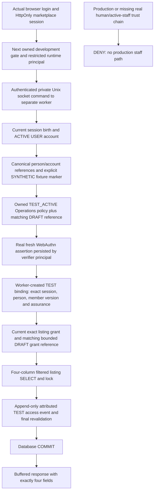

# First scoped listing read — Batch 6A actual architecture

24 October 2026 (Asia/Taipei). Baseline: clean `security/staff-operational-readiness-batch-5c`, **a7063ee2510dd83258eea156c1ed7245ee0164e6**. Isolated branch: `feature/scoped-staff-listing-read-pilot-batch-6a`.

## Actual development workflow

The real Next application serves `/dev/staff-listing-inspection` and POST `/api/dev/staff-listing-read`. Both are strictly disposable-development surfaces. The page explicitly labels **OWNED SYNTHETIC IDENTITY**; it is outside the legacy Admin layout because its test account remains UserRole.USER. Legacy ADMIN alone is rejected and never implies Operations membership.

The browser logs in through the existing marketplace form, enrolls/verifies using native WebAuthn and then requests one exact listing. `lib/webauthn-browser.ts` and the real Batch 5A standards verifier generate/verify actual challenges and signatures. There is no mock MFA success, synthetic proof flag or production policy MATCH acceptance. Registration alone creates no read binding; a signed fresh assertion is required.



The **test policy**, not the DRAFT records, permits this disposable experiment. Real public StaffMembership/StaffCapabilityGrant rows remain DRAFT and cannot become ACTIVE. Existing PENDING StaffSessionBinding/StaffStepUpRecord are never accepted as authentication. The fixture schema's distinct `TEST_ACTIVE` policy and test binding have no production meaning. Public VERIFIED person/association references are test-owned synthetic fixtures, not a claim that actual human proofing occurred.

## Fixed domain projection and scope

`lib/staff-read-pilot/read.ts` has a single listing selection:

```sql
SELECT id, status, category, "adminRestricted"
FROM public."Listing"
WHERE id = $1
  AND "ownerId" <> $2
  AND NOT EXISTS (
    SELECT 1 FROM public."StaffAccountAssociation" alias
    WHERE alias."userId" = "Listing"."ownerId" AND alias."personId" = $3
  )
FOR SHARE
```

The service returns a new literal `{id,status,category,adminRestricted}`. It does not import broad Admin listing helpers, spread Admin objects, select title/description/contact/media/evidence or expose counts/pagination. Exact grant lookup for member+listing, purpose, validity and policy occurs **before** this SQL; a missing grant never triggers a listing existence/count query. Unassigned existing and nonexistent listing IDs have the same denial. Owner and same-canonical-human owner aliases are filtered before selection. No operational mutation or station simulation is exposed.

A SHA-256 fingerprint of these four selected values is the bounded resource-version reference in the audit, not a permanent monotonic row version. Shared row locks serialize metadata changes until the read commits. The initial implementation attempted to select system-column xmin as an extra version reference; it was removed in favor of the exact projection and column-level SELECT privileges.

## Trust and transaction details

Each read uses one restricted read/audit PostgreSQL connection and READ COMMITTED transaction. Owned DB/schema markers and current development config are independently checked at the service boundary. Shared locks cover current AuthSession, User, permanent account association, canonical person, persisted authorization/MFA epochs, test member, referenced DRAFT membership, exact test grant, referenced DRAFT grant, active credential and selected Listing. Immutable proof/binding rows are read and reconciled. After lock waits, current rows are checked again by the transaction's SELECTs; expiry is checked with the current wall clock.

The chain requires current ACTIVE marketplace USER, exact session ID **and creation timestamp**, verified canonical references, explicit synthetic marker, proposed Operations fixture role, live test membership and matching bounded DRAFT reference. A real WEBAUTHN_UV assurance must match current account association/session incarnation, unrevoked registered key/RP, config hash, policy, lossless bigint authorization epoch/MFA version and validity. The worker issues a separate immutable fixture binding only after that assertion succeeds. A client binding UUID is merely a lookup; it cannot supply those facts.

For the resource, test grant/member IDs, versions, exact listing, action listings.read, fixture policy, validity and the DRAFT contract's RESOURCE/listing/OPERATIONS_METADATA scope all match. Unsupported roles/actions/selectors/flags deny. Client roles, identities, grants, case scopes, risk and policy versions are rejected rather than trusted.

Only after selection does the service insert the typed fixture audit, recheck deadlines and versions, await COMMIT and return the DTO. The worker sends JSON afterward; the app buffers the entire bounded worker response before creating its JSON response. No listing metadata is server-rendered/streamed by the page. Audit or final-check/commit failure rolls back and suppresses data; there is no log-and-continue branch.

The audit stores bounded actor/person/association/session-birth, member/grant/binding/assurance references, versions, exact listing, resource fingerprint, fixed action/policy/result, UUID correlation, DB writer identity and timestamp. No tokens/passwords/raw assertions/coordinates, listing bodies or arbitrary payloads. The result is **TEST_ACCESS_COMMITTED in the fixture schema**, never a production COMMITTED StaffSecurityEvent. Append-only and truncate-blocking triggers protect history; runtime has no insert/update/delete/truncate rights.

## Process and database boundary

`scripts/staff-read-pilot-worker.mjs` is a separate Node 24 worker. Restricted verifier and read/audit DB URLs arrive on a private stdin bootstrap pipe, never command arguments, app environment or browser payload. The app gets only its restricted runtime URL and a bounded-command channel secret. The private Unix socket is mode 0600 and run-specific, with a constant-time bearer comparison and 32 KiB request/response bounds. The channel authenticates a component, not a staff member: the worker independently resolves the opaque actual session and the entire persisted trust chain. It has no general audit-writer/grant/mutation command.

The worker checks its actual principals: neither may be superuser/CREATEROLE/CREATEDB/BYPASSRLS/schema creator/staff provisioner; verifier and read/audit users differ; only verifier can insert MFA assurances and only read/audit can insert test access audits. The app's current principal is rechecked and must lack schema creation/MFA assurance INSERT/success audit INSERT. An owner binding is refused rather than silently used for the pilot.

The fixture builds on Batch 5C's actual PostgreSQL principals. A sixth read/audit role has only needed identity/proof/contract reads, fixed listing column SELECT and guarded immutable-column UPDATE rights needed for PostgreSQL row locks. It cannot change those columns, provision staff, manufacture real proof or rewrite history. The verifier retains its restricted MFA rights. Public/draft references and test grants are created only by the trusted fresh-database fixture provisioner. New schema DDL lives in `tests/support/staff-read-pilot.ts`, not Prisma migration history; no production installation/provisioning script is added.

The Node entry resolves Next's server-only build marker for this private server process. It does not replace/mock cryptography, SQL, sessions or authorization. The worker imports the actual MFA service; no test policy evaluator manufactures a proof.

## Exact production blocker

This demonstrates separate processes and genuine SQL authority separation **inside a trusted disposable developer environment**. It does not certify hostile-process OS isolation. The app and worker run under the same development OS user, and the workspace may contain operator credentials in `.env`; process memory/filesystem access under compromise is not contained. An attempted isolated namespace launch was unavailable (`bwrap` could not set up a UID map on the read-only environment). No infrastructure permission escalation or production change was made.

Therefore the real staff path stays unimplemented/disabled. Production requires distinct secured service/OS/container identities, removal of migration/operator secrets from app-readable files, protected private transport/peer authentication, per-component secrets unavailable to general runtime, rotation/egress/observability and review of the verifier/writer trusted computing base. Do not call a second pool or same-user worker production-grade isolation. If the privileged worker is compromised, its trusted verifier credential can fabricate ledger rows; this prototype does not solve that threat.

`staffReadPilotConfig` permits only NODE_ENV=development, explicit owned-synthetic-only flag, exact localhost origin, strict matching local hustlen_test_* bindings, a current ownership marker and fixture schema marker. Proxy refusal happens before page rendering/private worker access in production and disabled development; worker startup also rejects production, and every domain transaction revalidates the development guard. No flag can make this a real active-staff path. Existing activation constraints remain untouched.

## Reproduction and cleanup

Use Node 24, installed lockfile dependencies/Prisma client, local PostgreSQL test credentials with database/ephemeral-role creation rights, and installed Chromium. Designate a **new** local `MRT_TEST_DATABASE_URL` named hustlen_test_* that differs from the application database; use `CHROMIUM_PATH`/`MRT_BROWSER_PATH` for the executable. Run `npm run test:staff-read-pilot`. The existing runner refuses an existing database name, creates/marks a fresh database, applies the unchanged 23 migrations there, launches the real restricted app and private worker, captures native-browser evidence, and removes owned schema/roles/database afterward. No raw URL/credential should be printed or placed in a command argument. Do not manually mark or clone a real user database to satisfy these guards.

The test runs as a trusted fixture provisioner; it is not a production staff provisioning or persistent demo launcher. It creates only synthetic people/users, DRAFT references and TEST_* policy/bindings. `.test-artifacts/<run>` retains ignored bounded evidence/server logs for review. Destroy only that owned run's temporary state; never disable historical audit triggers to delete individual records. Production/disabled refusal is also checked by the existing `test:mfa-pilot-production` and `test:mfa-pilot-disabled` actual-server suites, now extended for these two new surfaces.
