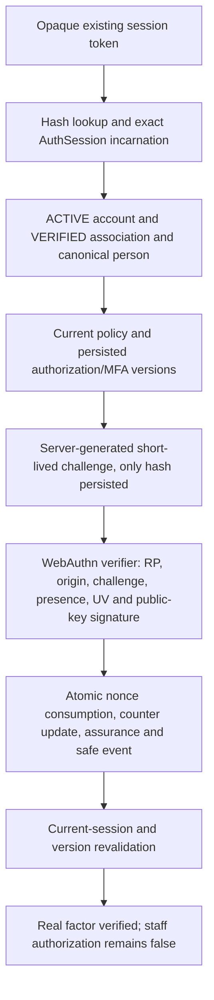

# Staff authentication and MFA foundation — Batch 5A

24 October 2026 (Asia/Taipei). Baseline: `c017ca878da65d44059988067ef6263448bd9875`, reviewed clean Batch 4B. Branch: `feature/staff-authentication-mfa-foundation-batch-5a`.

## Mechanism and approved boundary

The product owner selected **WebAuthn/passkeys as primary, without a TOTP fallback**. Production relying-party domains, recovery policy and mandatory enforcement are unresolved. This commit supplies a real cryptographic server service and an owned local browser acceptance harness. It adds no marketplace endpoint, staff login page, active membership, account conversion, MFA mandate, approval execution or privileged operation.

| Mechanism | Security and operational properties | Decision |
| --- | --- | --- |
| WebAuthn/passkeys | Asymmetric keys; verifier stores public keys, verifies origin/RP binding, signed challenge, user presence and user verification. Native modern-browser support; authenticator availability and recovery must be rehearsed. Synced passkeys do not prove hardware custody or a unique human. | Approved primary; implement verification foundation. |
| Authenticator-app TOTP | Broad app support; shared server secret requires encryption/key management; short codes remain phishable and require drift/replay windows. Recovery/fallback could downgrade passkey protection. | No implementation or fallback. |

`@simplewebauthn/server@14.0.3` performs actual registration and assertion verification. ES256 and RS256 are the only accepted registration algorithms. Tests generate real P-256 key pairs and signatures and additionally use Chromium's native WebAuthn API with a virtual CTAP2 authenticator; they do not mock the verifier. This proves protocol integration, not real-device biometric behavior or production deployment readiness.

## Existing authentication reviewed

* `lib/auth.ts`: salted scrypt password verification, timing-safe comparison, opaque random 32-byte session token, SHA-256 token hash in `AuthSession`, seven-day expiry, HttpOnly/SameSite=Lax cookie, Secure in production. Logout deletes the current session; expiry invalidates/deletes it. Session identifiers alone are insufficient for MFA: creation time is also bound.
* `app/api/auth/login/route.ts`, `lib/auth-rate-limit.ts`, `lib/auth-request.ts`: JSON/body bounds and persistent email-scoped login throttling. Existing marketplace login does not itself exclude suspended accounts; protected Admin guards require ACTIVE, and rental obligations remain separately protected. No change to this behavior.
* `proxy.ts`: mutation Origin/Host and cross-site checks, no-store private responses, cookie variation and nosniff. Future MFA endpoints must use explicit approved origins plus this transport protection, bounded JSON and secure cookies. Ingress must reject untrusted Host/forwarded headers. The new service never derives its trusted RP from a request header/body.
* `lib/admin/auth.ts`, existing Admin/API guards and ChatReviewer checks remain unchanged. Legacy ADMIN is still broad and is not yet MFA-enforced. This batch does not claim to fix that exposure.
* Batches 3A–4B persisted identity/epochs, scoped-read candidates and PENDING step-up/session/security/approval records are foundations, not cryptographic authentication. Their activation-blocking database constraints remain installed. Synthetic TEST_VERIFIED execution fixtures remain isolated and are never accepted as MFA proof here.

## Enrollment and assertion chain

`lib/authorization/mfa/config.ts` requires explicit server-owned exact-host RP/origin configuration, HTTPS except development localhost, canonical origins and a bounded RP name. Its configuration digest binds protocol, origin, RP and algorithm policy. No production domain/default/feature flag is provided.

`lib/authorization/mfa/service.ts` reconciles the actual session, ACTIVE user, VERIFIED association, VERIFIED canonical person and current persisted authorization policy. No identity-proofing authority is invented. Verified associations must come from a separately approved provisioning process; no such process is exposed here.

First enrollment requires the current password at begin and finish plus verified identity prerequisites. The server generates the challenge and opaque association-derived user handle. Registration requires user verification and accepts only privacy-preserving `fmt=none`; no external attestation trust fetch or hardware provenance is assumed. An enrollment creates a public-key record but **does not create verified step-up assurance**. A signed authentication assertion is required afterward. Once any key has ever existed, adding/replacing a key additionally requires fresh real assurance at both enrollment stages; revoking all keys cannot restore password-only enrollment.

Challenges bind association, exact session ID/birth, purpose, authorization epoch, MFA version and configuration. They expire within 299 seconds or session expiry, whichever is earlier. Five failed proofs cancel a challenge. Persistent canonical-person/operation budgets allow ten attempts per fifteen minutes, serialize concurrent operations and emit one limit event when exceeded. Aliases share the person-level budget. Expired/cancelled/consumed challenges cannot be reused; registration and authentication challenges cannot substitute for one another.

Successful assertions verify the stored credential, RP/origin/challenge, signature, presence, UV, optional user handle and authenticator counter through the standards library. Zero-counter authenticators rely on unique challenge consumption; counters are not the sole replay defense. Assertion digest uniqueness is an additional barrier. Transaction locks serialize same-association operations; replay and concurrent consumption are tested. Database/audit failure rolls back nonce consumption, counter and assurance together. Revocation before an authentication obtains the version lock is observed and denies it; operations already holding the lock serialize before later revocation. No asynchronous/global exactly-once guarantee is claimed.

Assurance expires within 299 seconds/session expiry. It binds credential, association, exact session birth, current authorization epoch, MFA version, policy and config. Logout/session deletion, reused integer session IDs, expiry, suspension, changed canonical identity/epoch or factor revocation invalidate it. Key addition/revocation increments the MFA version and invalidates earlier proof. Session/person/association locks and final time/version checks prevent release after in-transaction expiry or revocation. Future writers must obey a reviewed consistent lock order; unexpected contention/deadlocks deny rather than retrying privileged effects.

## Additive storage

New forward-only migration: `prisma/migrations/20261024180000_staff_webauthn_foundation/migration.sql`. Historical SQL is unchanged.

| Model | Purpose and constraints |
| --- | --- |
| StaffMfaVersion | Positive per-association revocation epoch; server increments on key changes. |
| StaffMfaCredential | Credential ID, COSE public key, bounded counter, RP, device/backup metadata, terminal revocation. No private key. Immutable identity/key, monotonic counter, no revival/delete. |
| StaffMfaChallenge | Hash only; bound context, at most five attempts, pending/consumed/cancelled, at most five-minute lifetime. Binding/history cannot be rewritten. |
| StaffMfaAssurance | Append-only, short-lived real assertion result, exact session/context versions, unique assertion digest, fixed WEBAUTHN_UV assurance. |
| StaffMfaEvent | Append-only bounded typed event with correlation, association/session and optional challenge/key identifiers. No arbitrary payload. |
| StaffMfaRateLimit | Persistent hashed canonical-person/operation budget and reset deadline. |

New tables start empty; only inverse Prisma relation fields are added to the existing association model. No UserRole/AuthSession/ChatReviewer/audit/booking columns change. There is deliberately no foreign key from the new tables to AuthSession: existing logout can still delete a session. Every factor use checks the current exact session incarnation.

Public keys/credential IDs are required verifier data, not passwords; they still deserve access controls and data minimization. Raw challenges, assertion bodies, attestation objects, password values, session tokens, private keys and connection errors never enter general audit records. New unexpected failures use `lib/operational-error.ts` bounded categories and correlation IDs; expected failures have generic external errors and typed events. The injected audit-failure test deliberately produces one such diagnostic.

Append-only tables and populated-truncation protection preserve evidence; no retention worker is activated. Expired challenge/proof hashes and event metadata currently remain. Before production, approve a retention/archive design and privileged-writer policy; do not bypass triggers with a cleanup script. Table owners/superusers can bypass constraints, and arbitrary trusted-writer inserts could forge assurance rows. Database constraints cannot verify WebAuthn signatures. Production must isolate verifier writes, restrict runtime credentials and prohibit arbitrary grant/assurance insertion before any consumer trusts this ledger.

## Staff session bridge and recovery

`inspectStaffTrust(token, assuranceId)` loads the persisted proof and current credential/session/person/epoch, then reads membership/grant readiness. It **always returns staffAuthorized=false**. DRAFT, PENDING, revoked or forged client roles do not become authority; even an unexpectedly ACTIVE membership cannot create a live staff context. It does not upgrade `StaffStepUpRecord` or `StaffSessionBinding`, issue a staff cookie, accept a pending proof reference, or invoke legacy ADMIN/approval handlers. Existing persisted grant changes bump the person authorization epoch. A future real issuer must additionally revalidate ACTIVE bounded membership/grants, their scopes, policy/version, conflicts, expiry and audit in its own atomic boundary; this batch intentionally cannot issue that context.

Recovery is explicitly disabled and audited/rate-limited. Password, email, pending records, another account alias, manual flags or last-factor revocation cannot reset MFA. A user can revoke the final factor only with the current password and fresh signed assurance; subsequent enrollment remains blocked pending an approved recovery process. This does not lock legacy Admin out because mandatory MFA has not been enabled. Production recovery and emergency-access policy must be settled before enforcement; no emergency bypass account/code is introduced.
