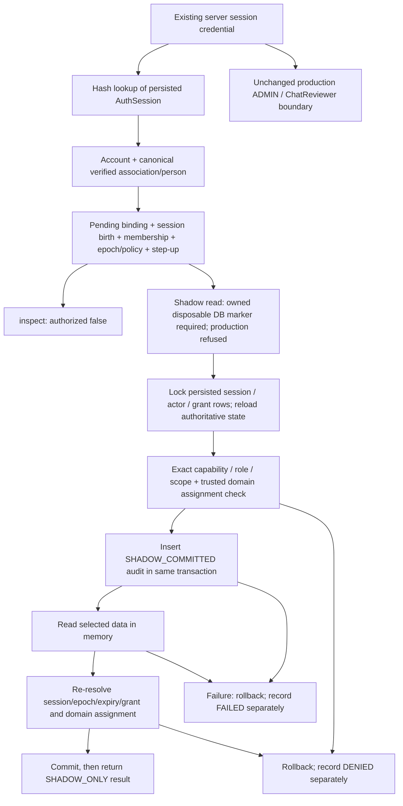

# Trusted staff session and audit foundation — Batch 3C

24 October 2026 (Asia/Taipei). **Non-activating.** Pending records and shadow results are never staff credentials or production authorization.

## Implemented persistence and trust chain

Source: [schema](../../prisma/schema.prisma), [forward migration](../../prisma/migrations/20261024140000_staff_session_audit_foundation/migration.sql), [server foundation](../../lib/authorization/scoped/session-audit.ts).

| Record | Binding and integrity | Meaning / limitation |
| --- | --- | --- |
| StaffStepUpRecord | Exact AuthSession ID **and creation timestamp**, verified account association, fixed MFA assurance marker, opaque issuer/proof references, unique proof reference, authenticated/expiry timestamps | PENDING or terminal REVOKED only. At most 15 minutes, never beyond marketplace-session expiry. It records a proposed attestation; it does **not** verify an MFA provider or issue an authentication token. No live issuer/verifier is implemented. |
| StaffSessionBinding | Exact session ID/birth timestamp, association, canonical person's DRAFT membership, step-up record, persisted bigint authorization version, policy, bounded expiry, provenance | PENDING or terminal REVOKED only; one pending binding per session. Session, person, membership, policy/version and time windows must match. Immutable except terminal revocation. Pending records confer no authority. |
| StaffSecurityEvent | Correlation UUID, derived person/account/session/membership/binding IDs, captured authorization version, fixed policy, canonical action/resource, bounded case/photo references, outcome/reason, timestamp and DB actor | Append-only; no metadata JSON, tokens, proof material, passwords, messages, coordinates or evidence bytes. COMMITTED is reserved but rejected by a CHECK constraint. Only DENIED, FAILED and distinctly labelled SHADOW_COMMITTED are usable. |

New relations add only inverse Prisma fields on StaffAccountAssociation and StaffMembership. Existing User, AuthSession, UserRole, ChatReviewer, booking/evidence and AdminAuditLog fields remain unchanged. Session IDs intentionally have **no new AuthSession foreign key**: existing logout, expiry cleanup and cascading session deletion must continue working. Historical attribution persists through the immutable binding reference; absent sessions deny. Session birth timestamps prevent a deleted/reused integer ID inheriting a pending binding. They are not token material.

SQL validation checks cross-account/person/member/session mismatches, validity/epoch/policy, immutable bindings, terminal revocation and bounded attestation windows. Event insertion derives actor fields from persisted bindings and rejects inconsistent supplied values. A shadow-success event additionally needs a current bounded pending identity/session/grant/contract chain. Unknown actions use a fixed sentinel with no resource payload; real production-success outcomes are impossible. Important CHECK predicates use explicit non-null conditions where appropriate. There are no SECURITY DEFINER functions or legacy updates/backfills.

## Server attribution boundary

`createPendingSessionAudit` accepts only the existing session credential plus action/resource selectors. No caller-provided actor, role, membership ID, human proof, policy/epoch, outcome or arbitrary metadata is an authorization input. Session tokens are hashed using the existing SHA-256 convention solely for AuthSession lookup and are never persisted in new records or logged.

The private resolver loads the current session/account, verified permanent association/person, single open membership, current authorization epoch, exact policy and step-up/binding windows. The read path requires DRAFT records, exact role-eligible DRAFT grants, matching resource/case and current validity; this is a **synthetic inspection path**, not treatment of DRAFT as production ACTIVE. There is no public permit constructor, live context issuer, staff login endpoint or singleton installed in existing routes. `inspect` always returns `authorized:false`.

Denial/failure attribution is separate from authority: a still-authenticated account with a verified canonical association can be attributed after its membership, grant, binding or step-up is revoked. Such an event captures the binding's attempted authorization version, never grants access, and never claims fresh human step-up. Missing/expired/deleted/reused sessions and unverified mappings remain unattributed. This distinguishes a known denied account from an anonymously forged token without trusting browser actor fields. Internal diagnostics must not be exposed as a public identity-existence oracle.

## Audit and failure semantics

The read callback and domain dependency are server-installed test seams. `readShadow` refuses NODE_ENV=production and requires the existing strict local `hustlen_test_*` URL, matching runner environment and the database's exact ownership marker read from the actual transaction connection. This is a test restriction, never a role-activation flag. No callback can run merely because a pending record exists. The default composition has no domain checker and denies every read.

Audit inserts precede sensitive retrieval; the transaction must commit before any result returns. Failed reads, failed final checks and aborted commits cannot leave a successful shadow event. A separate transaction records DENIED or FAILED using the same server-generated correlation ID. Failure reasons are fixed codes, not raw exception messages or request bodies. Unexpected errors use the existing bounded structured logger. If both the access audit and attempt-event store are unavailable, no data returns; a bounded operational error is emitted and the caller receives an audit-unavailable failure. A storage outage can prevent recording the attempt itself; monitoring/recovery is required, never fail-open access.

No unrestricted writer endpoint, arbitrary-event API or production-success writer exists. SQL triggers prohibit event edits/deletes and populated truncation; PUBLIC write rights are revoked on all three tables. These controls defend ordinary application DML and accidental edits, **not** a DB owner/superuser disabling triggers, forging matching inserts or altering constraints. The service proves credential-to-record mapping within the application trust boundary; an INSERT-capable compromised database principal is not cryptographically attested as the human. Separate runtime/migration/audit writer privileges and independently protected provenance remain production blockers.

## Integration-ready boundaries

The service restricts selectors to the eight current read capabilities used by Batch 3B: bookings, listings, users, disputes, listing reports, chat cases, audit projections and rental evidence. Exact resource grants remain mandatory even for Super Admin. Case requirements mirror the role-specific Batch 2B contracts; sensitive rental bytes additionally require an exact evidence UUID. Private support channels, mutations, approvals, AI and payments are unsupported.

`PendingShadowDomain.check` is the explicit seam for authoritative domain assignments, canonical participant/subject/investigator conflicts and evidence/version bindings. The owned fixture implementation reads real dispute/booking/photo rows and shared-locks a synthetic assignment table. It is not a production assignment model or a complete alias-conflict adapter. The production schema still lacks general staff assignments and trusted access-purpose provenance; they must deny until separately implemented.

The existing Batch 3B field-limited [visibility matrix](SCOPED_DATA_ACCESS_ARCHITECTURE_BATCH_3B.md) remains the intended ceiling. Neither existing broad Admin helpers nor lower-role endpoints are wired into this foundation. Future integration must extract exact scoped SELECT operations that accept this **same transaction**, bind resource/evidence versions and return field-minimized DTOs. Do not call Batch 3B's transaction-owning factory inside this wrapper: independent/nested transactions do not make audit and data access atomic. Its external boolean fence remains an earlier prototype; this batch does not silently replace its runtime semantics.

Future independent approval records need a separate reviewed proposal/decision/execution model, canonical human conflicts, exact payload/resource/evidence/policy/version binding and execution transaction. No approval capability is accepted by this read seam, and no approval records or executor are implemented.
