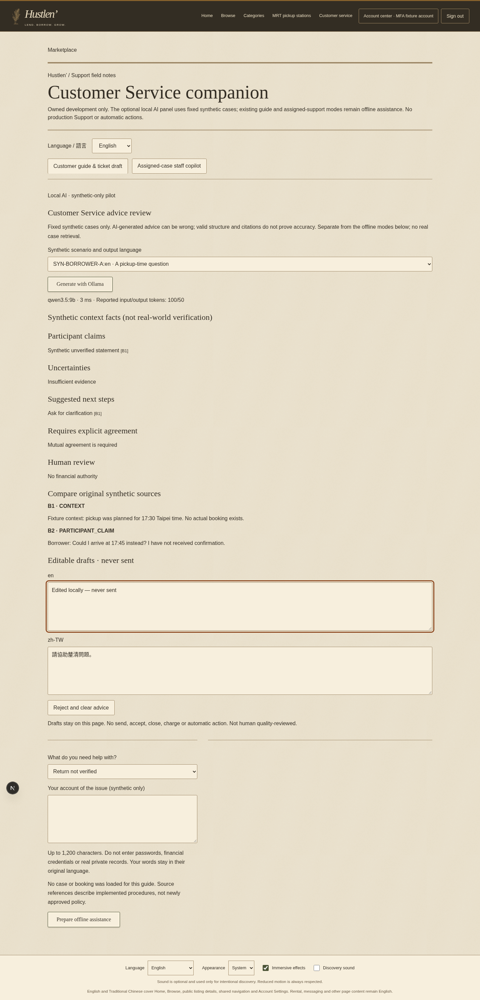
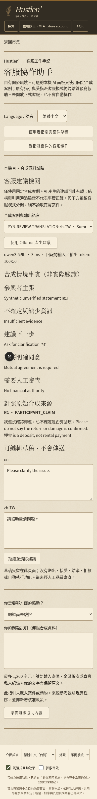
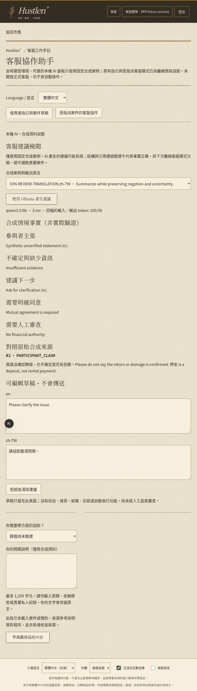

# Real application screenshots — MOCK inference transport

These are actual Chromium pages using the committed candidate, real native authentication and a freshly owned disposable database. **The loopback Ollama daemon is explicitly mocked. Text, model label, displayed timings and100/50 token counters in these images are test data, NOT measurements or output from Qwen.** Genuine model screenshots remain unavailable. No product-owner aesthetic or quality acceptance is claimed.

Existing heritage materials/typography/theme/localization are reused; no new visual assets, sounds or effects. English desktop shows a locally edited unsent draft. Traditional Chinese tablet/mobile show localized controls and authored mock drafts; English mock summary text is not a translation-quality result. Keyboard focus and no horizontal overflow were checked at1440/820/390. No full-site redesign or screen-reader certification.

## local-ai-desktop

## local-ai-mobile

## local-ai-tablet

