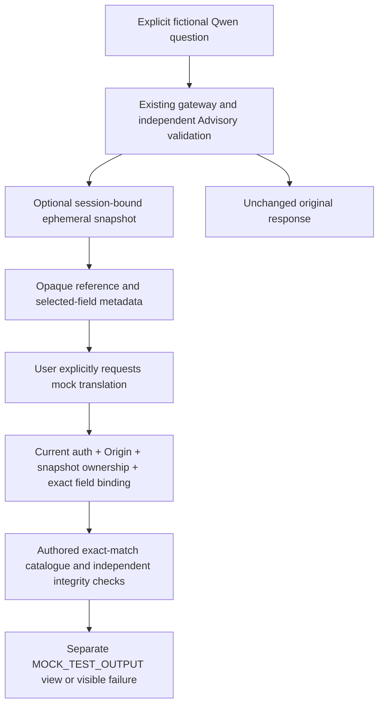

# Milestone 4B — independent mock translation sidecar

31 October2026, Asia/Taipei. **Development candidate; authored mock output only.** Baseline: clean `docs/independent-translation-architecture-milestone-4a`, HEAD `07f04a5bdcc66947fd93382320a4fc4a840cb27a`. Branch `feature/mock-translation-sidecar-milestone-4b`.

## Baseline audit and feasibility verdict

Reviewed M4A research/contract/evaluation proposals, original `lib/local-inference/gateway.ts` and `contracts.ts`, bilingual instructions/drafts, M5A knowledge, M5B Case Notes, M5C handoff, application i18n, M3 dataset/review contracts and M7A/B Vision contracts/guards. Their reasoning, source validation, corpus hashes, locale identifiers, review status and pending genuine acceptance remain intact.

Existing playground had browser-memory replies only; browser-supplied reply text would not be an authoritative translation input. A **bounded current-session server-memory snapshot** can safely solve that development-only gap without migrations or a broad data service. This is the justified additive mechanism, not a new reasoning/evaluation/authentication system.

No provider was selected, activated or contacted for translation. No translation model downloaded/executed. No new credentials, private-record retrieval, Vision connection, production Support, financial/custody/dispute action or production rollout. Original14-stage roadmap and unfinished commitments unchanged. Genuine M3B, Qwen, Vision and M5A–C acceptance remains owner-deferred.

## Implemented flow and UI

Optional sidecar appears per eligible Playground/Grounded/Case Assistance reply only when separately enabled in the existing protected runtime. User chooses en/zh-TW target and one allowed original-response field, then explicitly clicks Request mock translation. No automatic translation on reply/language selection, conversation traversal, new conversation, reset or page load.

Original Qwen response/drafts/source panel stay unchanged. Result displays original text and a separately labelled **authored mock translation (unreviewed)**, MOCK_TEST_OUTPUT, measured **mock** operation latency and non-authoritative risk hints. Same-language request returns NOT_NEEDED rather than inventing translation. No real-provider version, spend or fidelity grade.

Seven exact authored EN/zh-TW pairs cover deterministic fixtures, including clarification, unverified statement, evidence insufficiency, agreement/authority and one monetary/date/timezone example. Arbitrary genuine Qwen wording will usually return MOCK_UNAVAILABLE; this is honest limited coverage, not a general translator. No phrase substitution, model fallback, output repair or silent success. Case Notes summaries, source excerpts, user edits and Support payloads are never inputs to this translator. Existing prepared/confirmed Support text and its confirmation state are unaffected.

No major layout/CSS/localization rewrite: existing heritage surfaces, controls, spacing, focus, appearance and sound preferences retained. en/zh-TW operational copy; technical field paths and safe error codes unchanged identifiers. Expiry rendered in Asia/Taipei. Existing conversation notice now accurately discloses optional short-lived server snapshots rather than claiming everything is page-only.

## Canonical ownership, retention and bounds

- `lib/local-inference/server.ts` adds only optional hooks around the already validated result. It does not change gateway generation, model settings, output schemas, source classification, existing six-per-minute inference limit or fixed scenarios. Captures are limited to SYN-PLAYGROUND, SYN-GROUNDED-HELP and SYN-CASE-ASSISTANCE, not all historical fixed scenarios.
- Initial/current identity comes from `companionActor` plus persisted AuthSession selected by SHA256 of the actual current cookie, never browser actor/session selectors. Bind actor ID, session ID, creation timestamp, token hash and existing owned-test run ID into a private digest. Token/hash/session binding never returned in the descriptor. ACTIVE state and effective marked restricted runtime remain required.
- Recheck exact session incarnation after inference before capture, and before/after each translation operation. Deleted/expired/suspended sessions denied; another session of the same account cannot resolve the first reference. No ADMIN/staff fallback or new grants. Point-in-time checks are not universal cancellation/erasure of previously delivered content.
- Opaque random UUID responseRef; independent stable hash binding of exact original output, manifest and model. Reuses M3's stable object-key digest helper without modifying it; prefix sha256:. This new canonical/manifest binding is **not** a replacement for historical inputDigest/dataset/result hashes.
- Canonical data and descriptor recursively frozen after cloning/revalidation. Original source IDs/kinds, refs, participant side, Case Notes categories/stages and model remain in that immutable snapshot, never reconstructed from browser text.
- Maximum5 minutes, capped by session expiry; unref'd deletion timer plus lazy expiry sweep. Six snapshots/session (oldest in that session evicted),12/account,128/process,256KiB/canonical and4MiB serialized canonical+cached-result content. Descriptors/Map overhead bounded by counts; this is not a4MiB total Node heap claim.
- At most two unique successful request IDs cached per snapshot under the same memory budget. Identical request replay returns identical result only after fresh auth/ownership; changed content under same ID rejected.20 requests/session/minute and bounded rate-counter map. No automatic retries. Per-process limits/rates are not distributed production enforcement.
- Process-global versioned memory lets current Next development route bundles share the store. No database/file transcript persistence, migration, permanent snapshot or shared external cache. Restart, eviction or different worker yields STALE_SNAPSHOT and preserves browser original; never trust browser canonical text as fallback. Multi-worker durability is deliberately unsupported.
- Logout/reset does not synchronously zero every retained buffer. Revocation blocks new reads; page reset drops its references, server entries expire by timer/TTL or process stop. Normal event-loop timing, OS swap/crash dumps and previously authorized browser data are not cryptographic erasure guarantees. Synthetic-only warning is not an automatic detector of real PII entered contrary to instructions.

Snapshot failure cannot replace a valid original inference with a fake translation or fail the original Qwen response: extension is null/unavailable, original remains visible. Capture failures use existing bounded operational error logging, never transcript/raw cookie content.

## Additive contracts and independent validation

Actual types in `lib/translation-sidecar/types.ts`; strict request/field/literal checks in `contracts.ts` and mock-output checks in `mock.ts`.

| Contract | Binding and allowed data |
|---|---|
| translation-snapshot-v1 | Opaque ref, canonical/manifest digests, exact source locale, expiry, server-derived allowed paths, MOCK_ONLY. No actor/session token exposed. |
| advisory-translation-request-v1 | Exact keys: version,responseRef,canonicalDigest,targetLocale,fieldPaths,requestId. Browser cannot send canonical text/output, refs/kinds, role, source locale, provider, endpoint or authority. |
| advisory-translation-v1 success | AVAILABLE_UNREVIEWED or NOT_NEEDED; exact canonical/manifest/source/target/request binding; MOCK_TEST_OUTPUT; AUTHORED_MOCK_CATALOGUE/authored-translation-v1/model:null; separately mapped original/text digest/translated text; mock latency and warning codes. |
| advisory-translation-v1 failure | Explicit UNAVAILABLE/REJECTED/FAILED/CANCELED, safe allowlisted code, originalPreserved:true. No scripted translation, raw diagnostic body or real-provider claim. |

Allowed paths are only existing `knownFacts[i].text`, `participantClaims[i].text`, `nextSteps[i].text`, `uncertainties[i]`, `requiresAgreement[i]`, `humanReview[i]`, and the **one source-locale draft**. Runtime exact membership from that snapshot enforces valid indices; no wildcard or arbitrary JSON path. No notes labels/summary, source excerpts, knowledge catalogue, other-language draft, refs/kinds or authority fields selected.

Maximum16 fields/request,8000 Unicode scalar source values,32KiB source text; provider/mock raw output64KiB, each translated field4000 scalars and total16000. Existing destination limits remain unchanged: a sidecar does not write a longer value into an Advisory or Support submission. No truncation. Unknown extra/missing/duplicate output fields or wrong source-text digest/provenance rejected.

Source-locale guard is conservative script-based: mixed/unknown selected text refused under initial policy. English/zh-TW source metadata itself is not a semantic language attestation. Actual catalogue is exact-match; unsupported text unavailable. Target locale has no zh-CN/generic-language fallback. Script checks can have false positives/negatives and do not establish natural Taiwan terminology.

Literal integrity compares ordered explicit currency/amount, signed numeric, ISO date/time, UTC offset and IANA-zone tokens. Any mismatch rejected without repair, currency/timezone conversion or guessed date. This is **not** a complete natural-language date parser or semantic proof; negation, role, amount assignment and agreement require human review. Risk hints for negation/uncertainty/agreement/liability plus language-heuristic warning never count as a score. Structured role/source/authority fields cannot change because they are never returned from or edited by translation. Existing Advisory/source-aware schema unchanged.

## Authorization and runtime boundary

POST `/api/dev/support-companion/translation` only. Dedicated development `HUSTLEN_TRANSLATION_SIDECAR=mock-only` plus existing local-Qwen/Companion/owned-Support runtime guards. Independently production-disabled before auth/DB; proxy also refuses when disabled or production despite flag. Exact Host/Origin, no cross-site/query selectors, exact application/json and X-Hustlen-Translation:1. Current persisted session/account rechecked and opaque reference scoped. Bounded32KiB existing JSON reader, rate limits and exact request schema.

No arbitrary text endpoint, network client, provider credentials or translation inference transport exists. The only translator is a hardcoded authored catalogue. No modified Vision execution gate/source or private data reader. Existing en/zh-TW UI and M5A authored knowledge remain authored assets, not translation results.

The launcher adds only this explicit mock-only flag to its owned application child. It does not alter Ollama, native login, worker, disposable database, process lifetime or cleanup. Root inference integration adds optional response metadata and memory retention, not new inference calls.

## Verification and screenshots

See `verification.json` for commands/results, artifacts and cleanup. Unit cases test immutable ownership/session/expiry/eviction, exact field selectors, stale digests, metadata injection, idempotent requests, cache bound, literal amount/date/offset integrity, mock provenance, unknown coverage and bilingual reverse mapping.

Actual application test uses native login, restricted worker/runtime and fresh owned DB, with **authored mocked loopback Ollama responses, not Qwen**. It verifies two sessions of one account cannot share snapshots, another fixture actor denied, Origin/header/text/metadata/path tampering denied, stale digest, explicit request-only behavior, en/zh-TW views, unsupported wording failure, expired/deleted and suspended session refusal, rate/cache rejection UI, no extra model calls, no summary/Support preview overwrite, unchanged domain records and mobile/tablet/desktop width. Exactly one intentional429 resource console error is asserted in that negative UI case; any additional console or page error fails. No global error suppression/deadline increase.

Responsive screenshots in `screenshots/` are actual application **authored mock** results, not translation-provider performance or genuine Qwen acceptance. Full-page evidence remains in ignored test artifacts. Focused captures make the sidecar readable; mobile reviewed for overflow and legibility. No owner aesthetic acceptance implied.

Selected regression: original playground, Case Notes, M5C handoff, production refusal, Vision fixture UI, normal build and visible local-demo launcher. Static checks/unit include existing M3/Vision/auth/evidence contracts. No full camera/QR or genuine model regression represented as rerun. Databases only fresh guarded owned targets, original migration replay without modifying history; cleanup recorded. No existing application DB altered.

## Mac owner testing

After reviewing/checking out this branch locally and `npm ci`, use your **existing private guarded disposable-database startup wrapper** with `npm run demo:local-ai`. Launcher enables the mock-only sidecar while keeping the real local Qwen demo workflow intact. It opens native login/visible browser and remains running until Ctrl+C; existing PostgreSQL/Ollama services are not stopped by cleanup.

Send a fictional question as before (no real customer or sensitive data). Qwen generation is the existing separately authorized local feature; this batch's verification did **not** execute it genuinely. After a valid reply, inspect Optional mock translation, target and selected original field, then explicitly request. A matching authored phrase shows MOCK_TEST_OUTPUT; arbitrary Qwen wording normally shows MOCK_UNAVAILABLE, which is expected limited coverage. Original/ref panel and local edits stay unchanged. Same-language selection returns NOT_NEEDED. After five minutes/restart, stale request must fail while original remains readable. No automatic new Qwen call to refresh a snapshot. New conversation clears the page; server entries retain only their bounded TTL.

To reproduce deterministic application evidence instead: `npm run test:translation-sidecar` with a new guarded MRT_TEST_DATABASE_URL using existing private credentials. This uses mocked inference and closes after verification, unlike the playable launcher. `npm run test:unit` includes the five pure contract tests.

## Remaining prerequisites and stop boundary

This is not useful general translation yet. Owner must choose provider/product/pair, verify current supported Traditional Chinese/glossary/region/privacy/pricing terms, approve synthetic-only requests/budget/retention and exact field scope, define semantic language policy and genuine human fidelity/terminology acceptance. Real-provider adapter, operational retry/spending controls and eventual production authorization remain unimplemented. No existing rubric/corpus/human score/approval changed.

Memory snapshots are development-process scoped, not a distributed production transcript service. No automatic private data access, cloud egress, model download, Vision bridge, financial/custody/dispute decision, staff grants or Support submission. No paid calls, push, merge, deployment or next batch. Stop for owner review.

## Exact changed-file inventory

- `app/api/dev/support-companion/translation/route.ts`
- `components/local-ai-playground.tsx`
- `components/translation-sidecar.tsx`
- `docs/ai/milestone4b/REVIEW.md`
- `docs/ai/milestone4b/screenshots/desktop-mock.png`
- `docs/ai/milestone4b/screenshots/mobile-mock.png`
- `docs/ai/milestone4b/screenshots/tablet-mock.png`
- `docs/ai/milestone4b/verification.json`
- `lib/local-inference/server.ts`
- `lib/translation-sidecar/contracts.ts`
- `lib/translation-sidecar/engine.ts`
- `lib/translation-sidecar/mock.ts`
- `lib/translation-sidecar/server.ts`
- `lib/translation-sidecar/store.ts`
- `lib/translation-sidecar/types.ts`
- `package.json`
- `proxy.ts`
- `scripts/local-ai-demo.ts`
- `tests/local-ai.integration.test.ts`
- `tests/run-isolated.ts`
- `tests/support-staff-production.test.ts`
- `tests/translation-sidecar.test.ts`

Screenshots: [desktop](screenshots/desktop-mock.png), [tablet](screenshots/tablet-mock.png), [mobile](screenshots/mobile-mock.png). These focused native captures show authored mock output. Next development indicator can appear; it is not a product control.

Implementation SHA: `9615cc617bab4e06d41a5d98113bd6e81241da0d`. Separate closeout records final ledger. Final results:195/195 unit, TypeScript/lint, translation browser1/1, original playground1/1, Case Notes1/1, M5C handoff1/1, production refusal1/1, Vision fixture UI1/1, normal build and headed demo launcher pass. All inference responses in these tests are authored mocks; zero real translation/model-quality results. All selected disposable test databases cleaned up. No initial failing checks in M4B; final checks rerun after literal/typing/expiry-display refinements and focused screenshot additions.
