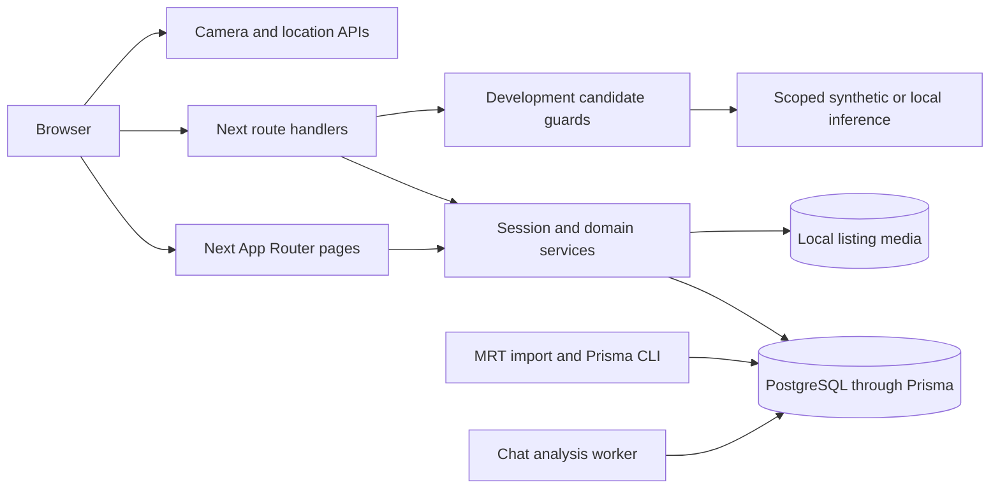

# Architecture audit

Canonical baseline `77aae95e950939483dd1418cf83c5261bc0ed67e`. Lend-Ya is a Taipei-focused peer-to-peer rental marketplace. The Next.js App Router serves server-rendered pages, client interaction, and JSON/multipart handlers from one application. The project also uses the Hustlen’ brand in the interface.

## Stack and runtime

| Layer | Canonical implementation |
|---|---|
| Runtime and server | Node 24.19.0 and npm 11.x. Next.js 16.4.3 App Router, React and React DOM 19.2.8 in the lock. Next's bundled runtime used a distinct canary React build in Mission 5. |
| UI and state | TypeScript 5.9.3, Tailwind CSS and its PostCSS plugin 4.3.3, shared React components and stylesheet tokens. Client React state, URL query filters, server cookies for locale, local preference hooks and browser APIs. No separate global-store dependency is declared. |
| Database | PostgreSQL 17 in Compose. Prisma CLI, client and PG adapter 7.10.1, pg 8.23.1. `lib/prisma.ts` creates the client and applies UTC connection settings. |
| Data and media | Checked-in official MRT data and import script. Listing media bytes on local disk and metadata in Postgres. Rental evidence bytes in Postgres. Sharp 0.35.5, QRCode 1.5.4, ZXing browser 0.1.5. FFmpeg/ffprobe for applicable video checks. |
| Authentication | Custom DB-backed sessions, Node scrypt, and explicit authorization helpers. SimpleWebAuthn 14.0.3 in isolated staff/passkey work. |
| Build and QA | Next CLI, Turbopack defaults with Webpack comparison support, ESLint 9.39.5, tsx 4.23.15, Node test runner and Playwright test 1.64.0. Direct playwright resolves 1.64.1. |
| AI and integrations | Authored fixtures and deterministic validators, scoped offline Support companion, loopback Ollama text pilot, mocked translation and separately gated Vision code including Gemini adapter selection. Browser geolocation and camera provide meetup signals. Canonical recovery has no delivery integration. |
| Deployment | PostgreSQL Compose service and GitHub Actions. No tracked application deployment manifest, platform attestation, shared media-store provisioner or production monitoring configuration was identified. |

Sources include [package lock](../../package-lock.json), [runtime pin](../../.node-version), [Compose](../../docker-compose.yml), [Next config](../../next.config.ts), [Prisma config](../../prisma7.config.ts) and [runtime gate](../../proxy.ts). Audited package advisories and version drift are in [Security and quality](SECURITY_AND_QUALITY_AUDIT.md).

## Navigation and service map

- [app](../../app) contains the marketplace home, listing creation/detail/editing, bookings and participant evidence, messages, Account, Admin, Support and isolated development pages. These use shared [components](../../components), including heritage navigation, marketplace, camera and locale controls. `app/layout.tsx` owns shell metadata, and `components/marketplace/home.tsx` queries marketplace discovery through `lib/marketplace`.
- [lib](../../lib) owns authorization, request parsing, persistence and domain policies. Booking endpoints combine `booking-policy.ts`, `booking-time.ts`, `rental-lifecycle.ts`, `booking-evidence.ts` and `meetup/`. Staff authority and approval rehearsals are under `authorization/`. Admin data projections, Support services and AI contracts have separate modules.
- [scripts](../../scripts) owns station import, DB preflight, local Admin creation, local demo harnesses and chat shadow analysis. The analysis worker leases jobs and publishes advisory results. Canonical code has no general payment or delivery worker.
- [tests](../../tests) holds file-based unit tests and the owned runner for API, browser, migration, application build and production-refusal suites. [.env.example](../../.env.example) defines required database and meetup variables and optional test configuration. Feature gates are read by their modules and `proxy.ts`. Gate inputs belong on the server.

## Database structure and integrity

The [Prisma schema](../../prisma/schema.prisma) declares 75 models. The [33 migrations](../../prisma/migrations) also carry predicates, CHECKs, triggers, append-only histories and restricted SQL roles/schema contracts that cannot be inferred from Prisma alone.

| Family | Relationships and integrity |
|---|---|
| Accounts and sessions | User has unique email and separate role and account status. AuthSession uses a token hash, expiry and a user FK. AuthRateLimit records persistent buckets. User owns listings and can participate independently as either rental party. |
| Catalogue and stations | Listing belongs to owner, ListingMedia to listing, ListingStation joins the listing and MRT station with composite uniqueness. Station codes and names are unique. Visibility incorporates status, moderation restriction and owner status in read scopes. |
| Rental | Booking references user parties, listing and selected station, with quoted price/deposit and state/time fields. Handoff and Return each use a unique booking link. Evidence links to booking with stage and uploader. Review uniqueness prevents duplicate party reviews. Dispute has a unique booking link. |
| Meetup | MeetupSession, CheckIn, Fallback, Challenge, Event and rate buckets link enrollment, participant consent/proximity and proof to booking and stage. A later SQL CHECK bounds physical confirmation. |
| Messaging and Support | ConversationParticipant and message ownership bind private users; idempotency and moderation records support report and decision history. Chat outbox/shadow job use unique identities, lease and state constraints. SupportTicket, lifecycle events, participant channel and messages extend the domain, and scoped worker objects under `hustlen_support_candidate` are implemented by SQL. |
| Administration and staff | AdminAuditLog tracks actions. Staff identity, account association, membership and grants are distinct from staff session binding, authorization generation, step-up, MFA, approval request/revision/decision and transitions. SQL guard triggers protect selected histories. |
| Candidate state | Announcement and typed display settings have event versions and mutation guards. Studio draft, photos, confirmed versions, selection, review context, claims and recovery room have separate persistence and immutable histories. Synthetic identity and most AI advisory state are ephemeral or fixture-based; they confer no real trust signal. |

`20261006150000_booking_lifecycle_backbone` builds the core rental records. Subsequent migrations extend installed history with MRT integration, hardening, chat, meetup, staff, Support and candidate rows. The migration chain relies on order and SQL-only invariants. The checked-in historical replay tests should run alongside fresh setup after fixing runtime access. Authenticated time display uses strict Taiwan formatting while the database connection uses UTC. Historical timestamp provenance remains an open data review issue [history](DEVELOPMENT_HISTORY.md).

Overlap coordination relies on the canonical service's row locks and overlap predicate, including [booking transition](../../app/api/bookings/[id]/route.ts) and [rental lifecycle helper](../../lib/rental-lifecycle.ts). Verify that any future importer or worker reuses the write rules before granting write access. Evidence retention and media durability are deployment decisions. See [Security and quality](SECURITY_AND_QUALITY_AUDIT.md).

## API responsibilities

- **Account and auth.** Session establishment/current-user/readback/logout and credential-backed login/registration are separate from account edits, password-change pilot, passkey pilot and the recovery placeholder. See [auth routes](../../app/api/auth).
- **Listings and bookings.** Listing handlers own catalogue writes and reporting. Media has a separate read route that queries visibility and selects the on-disk asset. Booking collection creates and lists participant records; item routes implement authorized state transitions, meetup operations, evidence delivery, handoff, return, inspection, review, and disputes. See [bookings](../../app/api/bookings) and [listings](../../app/api/listings).
- **Conversations and chat cases.** Conversation membership bounds messaging, read position, block/report, and meetup coordination. The chat case endpoint exposes user-facing case/appeal operations. Admin handlers handle case triage, claim, and decision separately. See [conversations](../../app/api/conversations) and [moderation](../../app/api/admin/chat).
- **Admin.** Scoped overview and workbench, accounts, listings, bookings, case and report queues, history and evidence, audit logs, settings, Support and MRT live inventory are separate read/write authorities. User status, listing moderation and case resolution have dedicated endpoints. Passkey and announcements candidates use additional gates. See [Admin routes](../../app/api/admin).
- **Support.** Requester ticket creation/detail, channel discovery and participant messages are distinct from the scoped staff candidate. Scope and production-refusal checks apply independently. See [Support routes](../../app/api/support).
- **Development APIs.** Each candidate service validates its own config, actor and inputs. These routes host identity simulation, inspection state, documentation, protected photos and versions, condition cases, mutual recovery, scoped staff reads, Support companion, translation and Vision fixtures. See [candidate routes](../../app/api/dev) and [proxy](../../proxy.ts).

## API inventory

The table is derived from tracked `route.ts` files at the baseline. Method exports describe registered handlers. Dynamic access and mutations remain conditional on the implementation and gate.

| Route | Methods | Source |
|---|---|---|
| `/api/account/password` | POST | [source](../../app/api/account/password/route.ts) |
| `/api/account` | PATCH | [source](../../app/api/account/route.ts) |
| `/api/admin/account-security` | GET | [source](../../app/api/admin/account-security/route.ts) |
| `/api/admin/ai-case-brief` | GET, POST | [source](../../app/api/admin/ai-case-brief/route.ts) |
| `/api/admin/announcements` | GET, POST | [source](../../app/api/admin/announcements/route.ts) |
| `/api/admin/audit-logs` | GET | [source](../../app/api/admin/audit-logs/route.ts) |
| `/api/admin/bookings/[id]` | GET | [source](../../app/api/admin/bookings/%5Bid%5D/route.ts) |
| `/api/admin/bookings` | GET | [source](../../app/api/admin/bookings/route.ts) |
| `/api/admin/chat/cases/[id]/claim` | POST | [source](../../app/api/admin/chat/cases/%5Bid%5D/claim/route.ts) |
| `/api/admin/chat/cases/[id]/decision` | POST | [source](../../app/api/admin/chat/cases/%5Bid%5D/decision/route.ts) |
| `/api/admin/chat/cases/[id]` | GET | [source](../../app/api/admin/chat/cases/%5Bid%5D/route.ts) |
| `/api/admin/chat/cases` | GET | [source](../../app/api/admin/chat/cases/route.ts) |
| `/api/admin/disputes/[id]/evidence/[photoId]` | GET | [source](../../app/api/admin/disputes/%5Bid%5D/evidence/%5BphotoId%5D/route.ts) |
| `/api/admin/disputes/[id]/history` | GET | [source](../../app/api/admin/disputes/%5Bid%5D/history/route.ts) |
| `/api/admin/disputes/[id]/resolve` | POST | [source](../../app/api/admin/disputes/%5Bid%5D/resolve/route.ts) |
| `/api/admin/disputes/[id]` | GET | [source](../../app/api/admin/disputes/%5Bid%5D/route.ts) |
| `/api/admin/disputes` | GET | [source](../../app/api/admin/disputes/route.ts) |
| `/api/admin/listings/[id]/moderation` | PATCH | [source](../../app/api/admin/listings/%5Bid%5D/moderation/route.ts) |
| `/api/admin/listings/[id]` | GET | [source](../../app/api/admin/listings/%5Bid%5D/route.ts) |
| `/api/admin/listings` | GET | [source](../../app/api/admin/listings/route.ts) |
| `/api/admin/locations/lab/[operation]` | POST | [source](../../app/api/admin/locations/lab/%5Boperation%5D/route.ts) |
| `/api/admin/locations` | GET | [source](../../app/api/admin/locations/route.ts) |
| `/api/admin/overview` | GET | [source](../../app/api/admin/overview/route.ts) |
| `/api/admin/platform-settings` | GET, POST | [source](../../app/api/admin/platform-settings/route.ts) |
| `/api/admin/reports/[id]/history` | GET | [source](../../app/api/admin/reports/%5Bid%5D/history/route.ts) |
| `/api/admin/reports/[id]/resolve` | POST | [source](../../app/api/admin/reports/%5Bid%5D/resolve/route.ts) |
| `/api/admin/reports/[id]` | GET | [source](../../app/api/admin/reports/%5Bid%5D/route.ts) |
| `/api/admin/reports` | GET | [source](../../app/api/admin/reports/route.ts) |
| `/api/admin/support` | GET | [source](../../app/api/admin/support/route.ts) |
| `/api/admin/users/[id]` | GET | [source](../../app/api/admin/users/%5Bid%5D/route.ts) |
| `/api/admin/users/[id]/status` | PATCH | [source](../../app/api/admin/users/%5Bid%5D/status/route.ts) |
| `/api/admin/users` | GET | [source](../../app/api/admin/users/route.ts) |
| `/api/admin/workbench` | GET | [source](../../app/api/admin/workbench/route.ts) |
| `/api/auth/admin-passkeys` | GET, POST | [source](../../app/api/auth/admin-passkeys/route.ts) |
| `/api/auth/forgot-password` | POST | [source](../../app/api/auth/forgot-password/route.ts) |
| `/api/auth/login` | POST | [source](../../app/api/auth/login/route.ts) |
| `/api/auth/logout` | POST | [source](../../app/api/auth/logout/route.ts) |
| `/api/auth/me` | GET | [source](../../app/api/auth/me/route.ts) |
| `/api/auth/register` | POST | [source](../../app/api/auth/register/route.ts) |
| `/api/bookings/[id]/dispute` | POST | [source](../../app/api/bookings/%5Bid%5D/dispute/route.ts) |
| `/api/bookings/[id]/evidence/[photoId]` | GET | [source](../../app/api/bookings/%5Bid%5D/evidence/%5BphotoId%5D/route.ts) |
| `/api/bookings/[id]/handoff` | POST | [source](../../app/api/bookings/%5Bid%5D/handoff/route.ts) |
| `/api/bookings/[id]/inspection` | POST | [source](../../app/api/bookings/%5Bid%5D/inspection/route.ts) |
| `/api/bookings/[id]/meetup/[operation]` | GET, POST | [source](../../app/api/bookings/%5Bid%5D/meetup/%5Boperation%5D/route.ts) |
| `/api/bookings/[id]/return` | POST | [source](../../app/api/bookings/%5Bid%5D/return/route.ts) |
| `/api/bookings/[id]/reviews` | POST | [source](../../app/api/bookings/%5Bid%5D/reviews/route.ts) |
| `/api/bookings/[id]` | GET, PATCH | [source](../../app/api/bookings/%5Bid%5D/route.ts) |
| `/api/bookings` | GET, POST | [source](../../app/api/bookings/route.ts) |
| `/api/chat/cases/[id]/appeal` | POST | [source](../../app/api/chat/cases/%5Bid%5D/appeal/route.ts) |
| `/api/chat/cases` | GET | [source](../../app/api/chat/cases/route.ts) |
| `/api/conversations/[id]/block` | POST | [source](../../app/api/conversations/%5Bid%5D/block/route.ts) |
| `/api/conversations/[id]/coordination` | POST | [source](../../app/api/conversations/%5Bid%5D/coordination/route.ts) |
| `/api/conversations/[id]/messages` | GET, POST | [source](../../app/api/conversations/%5Bid%5D/messages/route.ts) |
| `/api/conversations/[id]/read` | POST | [source](../../app/api/conversations/%5Bid%5D/read/route.ts) |
| `/api/conversations/[id]/report` | POST | [source](../../app/api/conversations/%5Bid%5D/report/route.ts) |
| `/api/conversations` | GET, POST | [source](../../app/api/conversations/route.ts) |
| `/api/dev/condition-cases` | GET, POST | [source](../../app/api/dev/condition-cases/route.ts) |
| `/api/dev/identity` | GET, POST | [source](../../app/api/dev/identity/route.ts) |
| `/api/dev/inspection` | GET, POST | [source](../../app/api/dev/inspection/route.ts) |
| `/api/dev/item-documentation` | GET, POST | [source](../../app/api/dev/item-documentation/route.ts) |
| `/api/dev/item-studio/photos/[id]` | GET | [source](../../app/api/dev/item-studio/photos/%5Bid%5D/route.ts) |
| `/api/dev/item-studio` | GET, POST | [source](../../app/api/dev/item-studio/route.ts) |
| `/api/dev/recovery-room` | GET, POST | [source](../../app/api/dev/recovery-room/route.ts) |
| `/api/dev/rental-documentation/photos/[id]` | GET | [source](../../app/api/dev/rental-documentation/photos/%5Bid%5D/route.ts) |
| `/api/dev/rental-documentation` | GET, POST | [source](../../app/api/dev/rental-documentation/route.ts) |
| `/api/dev/staff-listing-read` | POST | [source](../../app/api/dev/staff-listing-read/route.ts) |
| `/api/dev/support-agent` | POST | [source](../../app/api/dev/support-agent/route.ts) |
| `/api/dev/support-companion/local` | POST | [source](../../app/api/dev/support-companion/local/route.ts) |
| `/api/dev/support-companion` | POST | [source](../../app/api/dev/support-companion/route.ts) |
| `/api/dev/support-companion/translation` | POST | [source](../../app/api/dev/support-companion/translation/route.ts) |
| `/api/dev/support-requester` | POST | [source](../../app/api/dev/support-requester/route.ts) |
| `/api/dev/vision-fixtures` | GET, POST | [source](../../app/api/dev/vision-fixtures/route.ts) |
| `/api/dev/vision-prototype` | POST | [source](../../app/api/dev/vision-prototype/route.ts) |
| `/api/listing-media/[filename]` | GET | [source](../../app/api/listing-media/%5Bfilename%5D/route.ts) |
| `/api/listings/[id]/report` | POST | [source](../../app/api/listings/%5Bid%5D/report/route.ts) |
| `/api/listings/[id]` | GET, PATCH, DELETE | [source](../../app/api/listings/%5Bid%5D/route.ts) |
| `/api/listings` | GET, POST | [source](../../app/api/listings/route.ts) |
| `/api/support/channels/[id]/messages` | GET, POST | [source](../../app/api/support/channels/%5Bid%5D/messages/route.ts) |
| `/api/support/tickets/[id]/channel` | GET, POST | [source](../../app/api/support/tickets/%5Bid%5D/channel/route.ts) |
| `/api/support/tickets/[id]` | GET | [source](../../app/api/support/tickets/%5Bid%5D/route.ts) |
| `/api/support/tickets` | GET, POST | [source](../../app/api/support/tickets/route.ts) |

## Page route index

- `/account/activity`
- `/account/identity`
- `/account`
- `/account/verification`
- `/admin/account-security`
- `/admin/ai-case-brief`
- `/admin/announcements`
- `/admin/audit-logs`
- `/admin/bookings/[id]`
- `/admin/bookings`
- `/admin/case-audit/[id]`
- `/admin/chat/[id]`
- `/admin/chat`
- `/admin/disputes/[id]/history`
- `/admin/disputes/[id]`
- `/admin/disputes`
- `/admin/listings/[id]`
- `/admin/listings`
- `/admin/locations/lab`
- `/admin/locations`
- `/admin`
- `/admin/reports/[id]/history`
- `/admin/reports/[id]`
- `/admin/reports`
- `/admin/security`
- `/admin/settings`
- `/admin/support`
- `/admin/users/[id]`
- `/admin/users`
- `/admin/workbench`
- `/bookings/[id]`
- `/catalogue`
- `/customer-service`
- `/customer-service/tickets/[id]/channel`
- `/customer-service/tickets/[id]`
- `/customer-service/tickets/new`
- `/customer-service/tickets`
- `/dashboard`
- `/dev/announcements`
- `/dev/condition-cases`
- `/dev/inspection`
- `/dev/item-documentation`
- `/dev/item-studio`
- `/dev/recovery-room`
- `/dev/staff-listing-inspection`
- `/dev/support-agent`
- `/dev/support-companion`
- `/dev/support-requester`
- `/dev/vision-prototype`
- `/listings/[id]/edit`
- `/listings/[id]`
- `/listings/new`
- `/listings`
- `/login`
- `/messages/[id]`
- `/messages`
- `/profile/[userId]`
- `/register`
- `/`

## Model key and index index

Indexes here are Prisma declarations. Inspect SQL for database-only rules and role grants.

| Model | Primary, unique, and secondary indexes | Relation fields backed by local FK columns |
|---|---|---|
| `User` | `id @id`; `email @unique` | — |
| `AuthSession` | `id @id`; `tokenHash @unique`; `@@index([userId])`; `@@index([expiresAt])` | `user [userId]` |
| `MrtStation` | `canonicalId @unique`; `id @id`; `code @unique`; `name @unique` | — |
| `Listing` | `id @id` | `owner [ownerId]` |
| `ListingStation` | `id @id`; `@@unique([listingId, stationId])` | `listing [listingId]`, `station [stationId]` |
| `Booking` | `documentationContextId @unique`; `id @id`; `@@unique([renterId, requestKey])`; `@@index([listingId, status])`; `@@index([listingId, status, startAt, endAt])`; `@@index([ownerId, status])`; `@@index([renterId, status])` | `documentationContext [documentationContextId]`, `listing [listingId]`, `owner [ownerId]`, `renter [renterId]`, `meetingStation [meetingStationId]` |
| `Handoff` | `id @id`; `bookingId @unique` | `booking [bookingId]`, `performer [performedBy]`, `confirmer [confirmedBy]` |
| `Return` | `id @id`; `bookingId @unique` | `booking [bookingId]`, `initiator [initiatedBy]`, `confirmer [confirmedBy]` |
| `Dispute` | `id @id`; `@@index([status, createdAt])`; `@@index([bookingId, createdAt])` | `booking [bookingId]`, `opener [openedBy]` |
| `ListingMedia` | `id @id`; `@@index([listingId, createdAt])` | `listing [listingId]` |
| `ListingReport` | `id @id`; `@@unique([listingId, reporterId])`; `@@index([status, createdAt])` | `listing [listingId]`, `reporter [reporterId]` |
| `VerifiedReview` | `id @id`; `@@unique([bookingId, authorId])`; `@@index([subjectId])` | `booking [bookingId]`, `author [authorId]`, `subject [subjectId]` |
| `BookingEvidencePhoto` | `id @id`; `@@index([bookingId, stage])` | `booking [bookingId]`, `uploader [uploaderId]` |
| `AdminAuditLog` | `id @id`; `@@index([createdAt, id])`; `@@index([targetType, targetId, createdAt])`; `@@index([adminId, createdAt])` | `admin [adminId]` |
| `AuthRateLimit` | `key @id`; `@@index([expiresAt])` | — |
| `Conversation` | `@@index([lastActivityAt, id])`; `id @id`; `@@unique([listingId, ownerId, borrowerId])`; `@@index([ownerId, id])`; `@@index([borrowerId, id])` | `listing [listingId]`, `owner [ownerId]`, `borrower [borrowerId]` |
| `ConversationParticipant` | `@@id([conversationId, userId])`; `@@index([userId, conversationId])` | `conversation [conversationId]`, `user [userId]` |
| `ChatMessage` | `id @id`; `@@unique([senderId, clientMessageId])`; `@@unique([conversationId, sequence])`; `@@index([conversationId, updatedSequence])`; `@@index([conversationId, deliverySequence])`; `@@index([senderId, createdAt])` | `conversation [conversationId]`, `sender [senderId]`, `booking [bookingId]` |
| `UserBlock` | `@@id([blockerId, blockedId])` | `blocker [blockerId]`, `blocked [blockedId]` |
| `ChatReviewer` | `userId @id` | `user [userId]` |
| `ChatModerationCase` | `id @id`; `parentId @unique`; `dedupKey @unique`; `@@index([status, id])`; `@@index([assignedTo, status, id])`; `@@index([targetUserId, id])`; `@@index([reporterId, id])` | `conversation [conversationId]`, `message [messageId]`, `target [targetUserId]`, `reporter [reporterId]`, `reviewer [assignedTo]`, `parent [parentId]` |
| `MessageReport` | `id @id`; `dedupKey @unique`; `@@index([reporterId, createdAt])` | `conversation [conversationId]`, `message [messageId]`, `reporter [reporterId]`, `moderationCase [caseId]` |
| `ChatWarning` | `id @id`; `@@index([userId, id])` | `moderationCase [caseId]`, `user [userId]` |
| `ChatRateLimit` | `key @id`; `@@index([expiresAt])` | — |
| `ChatOutboxEvent` | `id @id`; `dedupKey @unique`; `@@index([processedAt, id])` | — |
| `ChatAnalysisJob` | `id @id`; `@@unique([messageId, analysisVersion])`; `@@index([status, availableAt, id])` | `message [messageId]` |
| `MeetupSession` | `bookingId @id` | `booking [bookingId]` |
| `MeetupCheckIn` | `id @id`; `@@unique([bookingId,userId,purpose,requestKey])`; `@@index([bookingId,purpose,userId,id])` | `session [bookingId]` |
| `MeetupFallback` | `id @id`; `@@unique([bookingId,purpose,ownerCheckId,borrowerCheckId], map:"MeetupFallback_check_pair_key")` | `session [bookingId]`, `ownerCheck [ownerCheckId]`, `borrowerCheck [borrowerCheckId]` |
| `MeetupChallenge` | `id @id`; `@@unique([bookingId,purpose,issueKey])`; `@@index([bookingId,purpose,createdAt])` | `session [bookingId]`, `ownerCheck [ownerCheckId]`, `borrowerCheck [borrowerCheckId]`, `fallback [fallbackId]` |
| `MeetupEvent` | `id @id`; `@@index([bookingId,id])` | `session [bookingId]` |
| `MeetupRate` | `key @id` | `session [bookingId]` |
| `StaffPerson` | `id @id`; `verificationSubjectHash @unique` | — |
| `StaffAccountAssociation` | `id @id`; `userId @unique`; `@@index([personId])` | `person [personId]`, `user [userId]` |
| `StaffMembership` | `id @id`; `@@index([personId, state])` | `person [personId]`, `proposedBy [proposedByPersonId]` |
| `StaffAuthorizationVersion` | `personId @id` | `person [personId]` |
| `StaffCapabilityContract` | `@@id([action, policyVersion])` | — |
| `StaffCapabilityGrant` | `id @id`; `@@index([membershipId, state])` | `membership [membershipId]`, `contract [action, policyVersion]`, `issuedBy [issuedByPersonId]` |
| `StaffAuthorizationEvent` | `id @id`; `@@unique([personId, authorizationVersion])` | `person [personId]` |
| `StaffStepUpRecord` | `id @id`; `proofRef @unique` | `association [associationId]` |
| `StaffSessionBinding` | `id @id`; `@@index([authSessionId,state])` | `association [associationId]`, `membership [membershipId]`, `stepUp [stepUpId]` |
| `StaffSecurityEvent` | `id @id`; `@@index([correlationId])`; `@@index([personId,createdAt])` | `binding [bindingId]` |
| `StaffChangeRequest` | `id @id`; `correlationId @unique`; `@@unique([requesterPersonId,idempotencyKey])` | `requesterBinding [requesterBindingId]` |
| `StaffChangeRevision` | `@@id([requestId,revision])`; `@@unique([requestId,revision,payloadHash])` | `request [requestId]` |
| `StaffApprovalDecision` | `id @id`; `idempotencyKey @unique`; `@@unique([requestId,revision])` | `request [requestId]`, `evaluatedRevision [requestId,revision,payloadHash]`, `reviewerBinding [reviewerBindingId]` |
| `StaffChangeTransition` | `id @id` | `request [requestId]` |
| `StaffMfaVersion` | `associationId @id` | `association [associationId]` |
| `StaffMfaCredential` | `id @id`; `credentialId @unique`; `@@index([associationId,revokedAt])` | `association [associationId]` |
| `StaffMfaChallenge` | `id @id`; `challengeHash @unique`; `@@index([associationId,expiresAt])` | `association [associationId]` |
| `StaffMfaAssurance` | `id @id`; `assertionDigest @unique` | `credential [credentialKey]`, `association [associationId]` |
| `StaffMfaEvent` | `id @id` | `association [associationId]` |
| `StaffMfaRateLimit` | `key @id` | — |
| `SupportTicket` | `id @id`; `initialEventId @unique`; `@@unique([id,requesterUserId],map:"SupportTicket_requester_identity_key")`; `@@unique([id,requesterUserId,requestKey,lifecycleVersion],map:"SupportTicket_identity_key")`; `@@unique([requesterUserId,requestKey])`; `@@index([requesterUserId,createdAt,id])` | `requester [requesterUserId]`, `booking [bookingId]`, `listing [listingId]`, `report [reportId]`, `dispute [disputeId]`, `initialEvent [initialEventId,id,requesterUserId,requestKey,lifecycleVersion]` |
| `SupportTicketEvent` | `id @id`; `@@unique([id,ticketId,actorUserId,correlationId,lifecycleVersion],map:"SupportTicketEvent_initial_key")`; `@@unique([ticketId,sequence])` | `actor [actorUserId]`, `ticket [ticketId,actorUserId,correlationId,lifecycleVersion]` |
| `SupportParticipantChannel` | `id @id`; `ticketId @unique`; `@@unique([ticketId,participantUserId],map:"SupportParticipantChannel_ticket_requester_key")`; `@@unique([id,ticketId,participantUserId],map:"SupportParticipantChannel_identity_key")` | `ticket [ticketId,participantUserId]` |
| `SupportMessage` | `id @id`; `@@unique([channelId,sequence])`; `@@unique([channelId,requestKey])` | `channel [channelId,ticketId,authorUserId]` |
| `Announcement` | `id @id`; `@@index([state, startsAt, expiresAt])` | `creator [creatorId]` |
| `AnnouncementEvent` | `id @id`; `requestId @unique`; `@@unique([announcementId, resultingVersion])` | `announcement [announcementId]`, `actor [actorId]` |
| `DevDisplaySetting` | `key @id` | `actor [actorId]` |
| `DevDisplaySettingEvent` | `id @id`; `requestId @unique`; `@@unique([key,version])` | `setting [key]`, `actor [actorId]` |
| `AccountSecurityEvent` | `id @id`; `@@index([actorId,createdAt])` | `actor [actorId]` |
| `DevItemDraft` | `listingId @id` | `listing [listingId]`, `owner [ownerId]` |
| `DevItemPhoto` | `id @id`; `@@index([listingId,createdAt])` | `listing [listingId]`, `owner [ownerId]` |
| `DevItemVersion` | `id @id`; `@@unique([listingId,revision])` | `listing [listingId]`, `owner [ownerId]` |
| `DevItemEvent` | `id @id`; `@@unique([listingId,revision])` | `version [versionId]`, `listing [listingId]`, `actor [actorId]` |
| `DevDocSelection` | `listingId @id`; `eventId @unique` | `event [eventId]`, `listing [listingId]`, `owner [ownerId]` |
| `DevDocSelectionEvent` | `id @id`; `@@unique([listingId,revision])` | `version [versionId]`, `listing [listingId]`, `owner [ownerId]` |
| `DevDocReviewContext` | `id @id`; `@@index([borrowerId,createdAt])` | `selection [selectionEventId]`, `listing [listingId]`, `borrower [borrowerId]` |
| `DevConditionClaim` | `disputeId @id`; `bookingId @unique`; `requestKey @unique` | `dispute [disputeId]`, `booking [bookingId]`, `owner [ownerId]`, `borrower [borrowerId]`, `agreement [agreementContextId]` |
| `DevConditionEvent` | `id @id`; `@@unique([disputeId,revision])`; `@@unique([disputeId,actorId,requestKey])` | `claim [disputeId]`, `actor [actorId]` |
| `DevConditionNotice` | `disputeId @id` | `claim [disputeId]`, `borrower [borrowerId]` |
| `DevRecoveryRoom` | `disputeId @id` | `claim [disputeId]` |
| `DevRecoveryProposal` | `id @id`; `@@index([disputeId,createdAt])` | `supersedes [supersedesId]`, `room [disputeId]`, `author [authorId]` |
| `DevRecoveryEvent` | `id @id`; `@@unique([disputeId,revision])`; `@@unique([disputeId,actorId,requestKey])` | `room [disputeId]`, `actor [actorId]`, `proposal [proposalId]`, `notice [noticeId]` |
| `DevRecoveryNotice` | `id @id`; `eventId @unique`; `@@index([disputeId,recipientId])` | `root [disputeId]`, `recipient [recipientId]`, `event [eventId]` |
