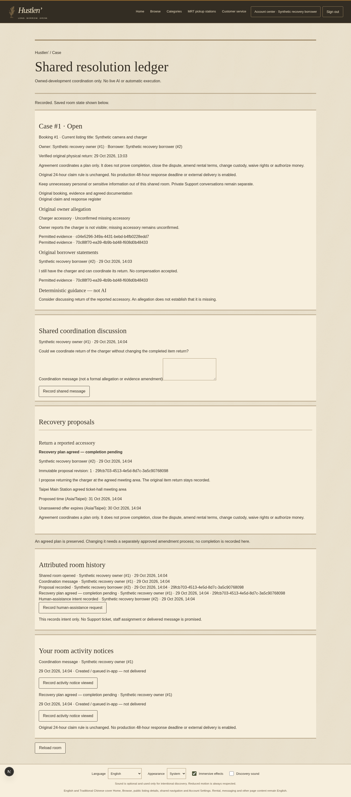
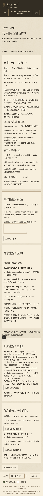
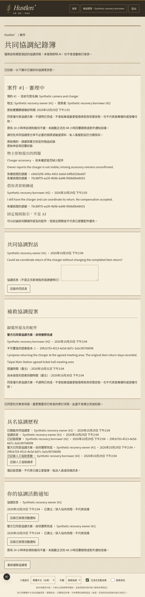
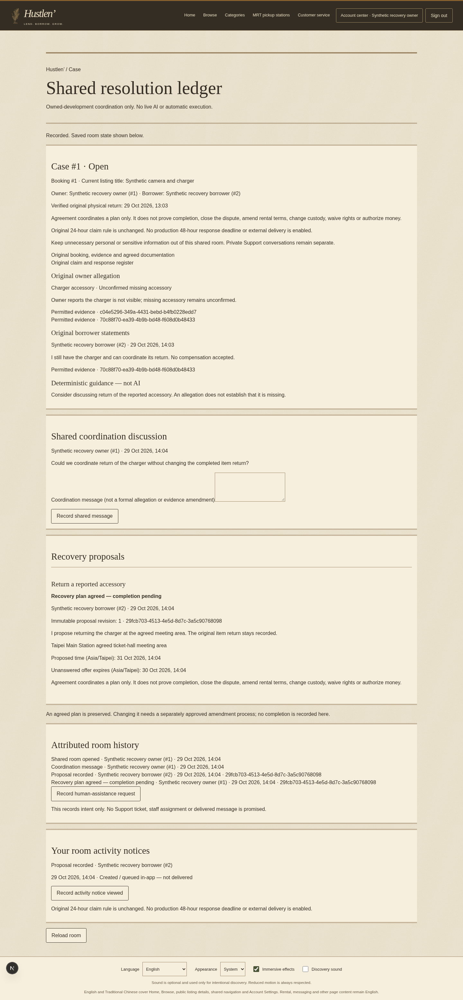

# Actual application screenshots

Synthetic owned-development fixture, not real customer records or product-owner aesthetic approval. Existing heritage materials and typography are reused; no new visual assets, effects or sounds. Native browser interactions precede captures; responsive widths 1440, 820 and 390. English desktop and Traditional Chinese tablet/mobile.

## resolution-borrower-desktop-en

## resolution-borrower-mobile-zh

## resolution-borrower-tablet-zh

## resolution-owner-desktop-en

