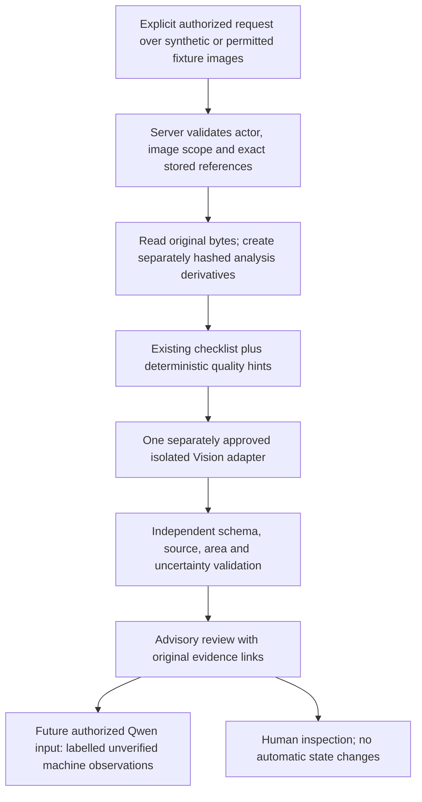

# Milestone 6 — Vision provider research and recommendation

Research checkpoint: **30 October 2026, Asia/Taipei**. Research/design only. Starting HEAD `a7dd661c5caa616f9bd7b92dc855c3925a42a3b7`, clean M5C branch. M5A–C are development candidates; genuine acceptance and M3B smoke testing remain owner-deferred. This report neither selects nor activates a provider.

## Recommendation and evidence limits

**Recommend a hybrid architecture: existing deterministic image preparation and checklist checks + one isolated vision-language model + independent advisory validation + human review.** Do not combine several billable providers in the first prototype. Keep the Qwen Customer Service text gateway separate.

Provisional prototype preference: **local Qwen3-VL-8B-Instruct**, subject to exact weight/quantization license, Mac memory/runtime compatibility and owner approval. This is a documented multi-image candidate, not a demonstrated winner. It is a different proposed model/artifact from the existing `qwen3.5:9b` text-only application path; no model change/download is authorized here. Consider a **single hosted OpenAI or Gemini comparison** only after price, residency, contractual and regional checks are completed. Claude is a reasonable third VLM candidate. Do not select Rekognition or Azure Image Analysis alone for semantic before/after reasoning; they are potential preprocessing utilities, not an established condition-comparison solution.

**Research limitation:** direct provider documentation, pricing and privacy pages were blocked by this environment's HTTP proxy (`Tunnel connection failed: 403 Forbidden`). Fourteen official SDK/repository source files were retrievable and inspected; nineteen documentation URLs were attempted and blocked. See [SOURCES.json](SOURCES.json) for exact URLs, status, UTC check time and SHA-256 of retrieved bytes. Blocked pages are references to verify, **not sources claimed as read**. Current exact prices, account quotas, Taiwan availability, data-residency promises, retention periods and service lifecycle cannot be certified from SDK code. No stale remembered prices or fixed retention claims are substituted.

Thus this is an actionable architecture and provisional shortlist, **not a completed current commercial due-diligence verdict**. Current pricing/regional/privacy verification must precede final provider selection. No images, model requests, credentials, paid calls, model downloads or benchmarks were sent/run. Ordinary public-document GETs are the only research egress. Provider examples were read, not executed.

Evidence labels below: **D** = documented in successfully retrieved official source; **P** = proposed architectural fit/inference, not performance evidence; **U** = unavailable/unverified in this research. A documented API field is not proof that every current model supports it, nor that outputs are true.

## 1. Repository audit

| Implemented area | Exact source | What exists and what does not |
|---|---|---|
| Category documentation | `lib/item-documentation/checklists.ts` | Version1 camera, power-tool and camping area checklists; conservative general fallback, accessory declarations and safe functional prompts. `pixelHints` supplies deterministic brightness/edge-energy hints, **not** object recognition, sharpness certification or damage detection. |
| Preview and comparison | `lib/item-documentation/service.ts` | Owned-development gate, listing-owner checks, booking-participant reads, stage-labelled evidence, checklist, receipt-derived pickup/return information. `areaMapping: UNRECORDED_LEGACY_EVIDENCE`, `vision: unavailableVision()`. Preview response explicitly saved:false/model unavailable. No model sees images. |
| Durable listing studio | `lib/item-studio/service.ts`, `lib/item-studio/contracts.ts`, `prisma/migrations/20261028160000_owned_item_documentation/migration.sql` | Owned-development versions/photos/events, optimistic revisions, owner-bound photo reads; immutable photo/version/event records via migration triggers. Photos have inputHash/storedHash, areaId, source, timestamp. Draft can change; original photo record is not overwritten by draft area selection. Owner confirmation is not verified physical condition/publication. |
| Prospective rental documentation agreement | `lib/rental-documentation/service.ts`, `lib/rental-documentation/contracts.ts` | Explicit selected confirmed version, digest and participant acknowledgement; exact version photo projection/authorization. Do not use latest listing photographs or backfill old rentals as agreed condition. |
| Rental image validation | `lib/booking-evidence.ts` | Up to8 files, 5MiB each,20MiB aggregate; JPEG/PNG/WebP; decode/type validation, no animation, max4096 each dimension and decoder pixel cap; orientation normalization, metadata stripping, resize inside2048² then re-encode. Existing limits remain authoritative. |
| Pickup/return persistence | `lib/rental-lifecycle.ts`, `lib/meetup/service.ts` | Booking participant/lifecycle checks, QR/camera/consent/physical-receipt dependencies, fresh BookingEvidencePhoto records with booking/uploader/stage/MIME/data/timestamp; completion digest includes normalized photo content. A Vision result must never substitute for these gates. |
| Private rental bytes | `app/api/bookings/[id]/evidence/[photoId]/route.ts` | Current session, exact booking participant and photo-booking relationship; private/no-store, same-origin, nosniff/sandbox headers. Having an evidence URL does not authorize provider export. |
| Admin evidence | `lib/admin/evidence.ts` | ACTIVE legacy ADMIN and dispute-scoped photo; committed EVIDENCE_VIEWED audit before releasing bytes. No new general staff/AI reader follows from this access. |
| Physical return/inspection | `lib/inspection/service.ts`, `lib/inspection/contracts.ts` | Verified receipt-derived return and24h inspection window, not page-load timer. Physical custody separately represented; historical current accessory declaration explicitly not necessarily rental snapshot. No money implementation or automatic causation finding. |
| Durable claims/responses | `lib/condition-claims/service.ts`, `lib/condition-claims/contracts.ts` | Owned-development participant claims, booking-scoped preserved evidence references, supplements/responses. Notification contract distinguishes created/queued/viewed/test-delivered;48h test timer non-enforceable, automaticLiability:false. Vision must not rewrite claims into findings. |
| Future Vision contracts | `lib/item-documentation/vision-contract.ts`, `lib/inspection/future-contracts.ts` | Allowed references, advisory:true, bounded uncertainty/confidence and strict field validation. First returns UNAVAILABLE; older inference function throws NO_APPROVED_VISION_PROVIDER. Overlapping contracts require a future reviewed adapter, not two competing inference systems. |
| Customer Service AI | `lib/local-inference/contracts.ts`, `gateway.ts`, `server.ts`, `case-notes.ts` and M5A–C modules | Text-only synthetic inference, independent source-kind validation, no image transport. knownFacts require CONTEXT; participant reports are claims. M5C requester handoff is user-confirmed, not an AI tool. No Vision observations are currently consumed. |

### Preservation qualifications and gaps

- **Stored original versus camera original:** rental upload validation deliberately transforms bytes and strips metadata. Preserve the existing normalized stored evidence unchanged; never claim it retains camera originals/EXIF. Do not alter ingestion or backfill hashes in this batch. A future derivative must identify its immutable stored parent, transform, dimensions and own digest. Studio inputHash is a digest, not retention of camera-original bytes.
- Legacy `BookingEvidencePhoto` migration (`20261013100000_private_rental_evidence`) defines stage/uploader/timestamp/byte constraints and booking cascade, but does **not** establish global database WORM/append-only protection for all photos. No universal tamper-proof retention claim is justified. Application create-only flows are narrower than database-wide immutability. Future persistence/retention and privilege review required before stronger claims.
- Existing comparison lacks dependable historical per-area mappings and paired camera viewpoints. Missing view must stay UNKNOWN, not “no damage.” Listing baseline is secondary; actual rental pickup evidence is primary.
- No Vision provider, genuine visual quality evaluation, damage valuation, authenticity test, eKYC/face matching, identity-document export or automated condition decision exists or is enabled.

## 2. Provider comparison

| Candidate | Multi-image / JSON / references | A listing; B pickup | C return comparison; D Support | Deployment and operational assessment |
|---|---|---|---|---|
| **OpenAI multimodal API** | D: SDK Responses image inputs (URL/base64), input-image type; JSON Schema output config with strict option. Model-specific multi-image count/budget U; repeated image items are possible API structure. Image IDs/crops must be server mapped, not presumed authentic citations. | P: suitable for labels, descriptions, visible accessory suggestions and area observations, subject to evaluation. | P: VLM approach suitable for jointly interpreting paired sets; fine scratches, counting, spatial alignment and confident misreading remain unproven. Neutral structured observations could feed Support after validation. | External API. Exact current supported vision model/snapshot, image tokenization, rate tier, latency, country eligibility, retention/residency and price U. Medium integration effort; provider schema support still needs model-level verification. |
| **Google Gemini, direct API or Vertex** | D: official SDK multimodal contents/parts and schema-config examples. P: joint photo-set reasoning; exact model context/image caps U. Server-owned image IDs/area mapping needed. | P: good shortlist for category/coverage/description; bilingual performance unmeasured. | P: plausible cross-image reasoning, not a specialist causal/damage detector. Must abstain on unmatched areas. | Direct Gemini and Vertex are separate commercial/data-processing choices. Exact model, price, free vs paid terms, region/global routing, quotas and snapshot availability U. Do not assume a Taiwan cloud region serves the chosen model locally. |
| **Anthropic Claude** | D: image content blocks (base64/URL/file source types) and structured format config in current official SDK. Exact model image limits/JSON support U. References need application mapping. | P: plausible descriptive and checklist reasoning. | P: plausible multi-image reasoning/neutral explanations, no verified Hustlen fine-detail advantage. | External API or separate cloud distribution; distinct terms and feature parity must be checked. Current price, supported countries, retention, regions, latency and quotas U. No reason to add a second hosted dependency before baseline comparison. |
| **AWS Rekognition Image** | D: current SDK operations include labels, image quality properties, Custom Labels; typed JSON results. Per-image detection is not general multi-image conversational reasoning. Bounding boxes can locate detections, not prove a pickup-to-return finding. | P: useful objective quality/object tags if needed; no evidence it can generate required nuanced descriptions or determine full accessory inventory. | Not recommended as sole C/D engine. Custom Labels would require labelled training data/model lifecycle and a separate evaluation; not out-of-box scratch/causation detection. | AWS regional service and IAM/S3/bytes pathways; pricing varies operation/region/volume, Custom Labels training/inference separately. Exact current rates/region eligibility U. Do not invoke faces/collections. Historical AWS guide says non-storage operations do not persist input bytes; that archival statement is **not** a current retention/training/legal guarantee. |
| **Azure AI Vision Image Analysis** | D: caption/dense captions, tags/objects/OCR, typed JSON with boxes; up to10 captioned regions. Single-image analyze; not a comparative VLM. | P: useful supporting labels/quality-like observations; official SDK says caption English-only and caption GPU-region restrictions, so not a standalone zh-TW solution. | Not recommended as sole C/D engine. “Similar” embeddings/captions do not establish a new scratch or absent accessory. A separate multimodal Azure-hosted model would be a different offering requiring its own review. | D: SDK documents <20MB, dimensions >50 and <16000, formats including JPEG/PNG/WebP. Do not expand Hustlen limits to match these. Current lifecycle/retirement, API version/region, terms/pricing U; mandatory check before new dependency. |
| **Self-hosted Qwen3-VL-8B-Instruct** | D: official repo multi-image inference, pixel-budget control and image/video reasoning examples; Ollama documents schema-constrained format. Exact chosen runtime/model schema compatibility U. Model image understanding and schema reliability unmeasured. | P: practical local synthetic prototype, potential bilingual fit; category details/quality/coverage still need human labels. | P: joint evidence-set reasoning possible; quantization/downscaling may erase fine defects. No documented guarantee of damage causation or complete inventory. | Local/offline after approved installation, no per-call provider invoice; memory, throughput, energy and maintenance costs remain. Repo LICENSE Apache2.0 verified; **specific weights/quantized redistribution license must still be verified**. Pin weights/digest, tokenizer, vision processor/runtime/settings. Existing Mac RAM unspecified; no promise8B fits or is fast. |
| **Self-hosted InternVL family** | D: official repo includes multimodal/multi-image recipes. P: reasonable alternative open-weight baseline; JSON constraints depend on serving stack/model. | P: alternative if local Qwen quality/memory unsuitable. | P: candidate only, not shown superior here. | More integration/model-selection/license work than reusing an approved local runtime. Exact checkpoint/weight licenses/hardware limits U. Do not assume the repository license covers every artifact. |

**Specialized comparison:** image alignment/features/pixel differences may assist closely matched views, but lighting, pose, reflections, compression and occlusion cause spurious differences. They cannot assign semantic damage or liability. Rekognition Custom Labels could be investigated only after a useful labelled defect dataset exists. No specialist commercial damage service is recommended without verified supported item domains, per-image provenance, privacy, pricing and held-out rental-photo performance; car/insurance inspection claims are not evidence for cameras/tools/tents.

### Cross-cutting constraints

- No candidate has independently verified Hustlen accuracy, latency or Traditional Chinese quality. All performance/latency measurements are **unavailable**. Provider marketing benchmarks are not this dataset.
- Multi-image capacity is not reliable matching. Exact photo→source mapping, paired-area IDs and one/more references per observation remain application responsibilities. JSON validity and reference existence are structural checks, not visual entailment.
- Fine scratches/reflections, occluded accessories, small text/serials, lens coating, water resistance and hidden function cannot be reliably resolved from ordinary photos. “Not visible” is not “absent.” Model confidence is not calibrated probability.
- Rate limits depend on model/account/region/token or image budget. Reserve bounded concurrency and per-run request limits; no automatic retries, no invisible fallbacks/provider switching. A timeout may still be billed.
- Pin dated model/snapshot where supported. If only mutable aliases exist, record alias+observed revision and repeat acceptance on change. Deterministic settings do not guarantee bit-identical hosted/local outputs.

## 3. Representative cost model

**Current prices: unavailable, not $0.** Current official pricing URLs are listed below and in SOURCES.json; all pricing-page retrievals failed. Consequently no vendor USD ranking, supposedly current rate or guaranteed prototype total is presented.

Define one comparison as **six pickup + six return photographs**, three checklist areas with overall/detail views. Proposed analysis copies have longest edge1536px, maintaining aspect ratio, with explicit selective detail crops only if approved. This proposed resolution is not implemented and might be inadequate for small scratches. Existing originals remain untouched. One call includes12 images,1200 text input tokens,800 output tokens; no retries. Actual token counts must come from the exact approved model's documented processor and returned usage, not a flat image assumption.

For token-priced provider, let `q` be effective image tokens per image, `I/O` be USD per million input/output tokens, `R` any separately charged reasoning tokens/cost, `S` storage/egress/taxes. Then:

`comparison = ((1200 + 12q) × I + 800 × O) / 1,000,000 + R + S`

Token sensitivity **not provider billing estimates**:

| Hypothetical q/image | Input/comparison | 24 comparisons | 1000 comparisons |
|---|---:|---:|---:|
| 500 | 7200 | 0.1728I + 0.0192O | 7.2I + 0.8O |
| 1500 | 19200 | 0.4608I + 0.0192O | 19.2I + 0.8O |
| 3000 | 37200 | 0.8928I + 0.0192O | 37.2I + 0.8O |

Dollar amounts result **only after verified rates are substituted**; none are approved spending. Four2x crop images would add4q tokens under the simplified constant-q illustration, but actual crop tokenization varies. Text translation/Qwen calls, preprocessing, failed requests, storage and infrastructure are additional. Batch/discount/cache/free-tier assumptions are excluded. Do not count presumed thinking-token limits as hard spend enforcement.

For per-image utilities:12 × applicable image-operation price/comparison (or0.012×price-per1000 if published in that unit). At24 comparisons288 image operations; at1000 comparisons12000. Multiple separately metered features can multiply this. Custom Labels training and billed running inference time require a different quote, not this per-image formula.

For local model: `amortized hardware + runtime/maintenance + electricity + storage`. Illustrative assumption only: extra50W for60s costs0.000833kWh/comparison; at1000 comparisons0.833kWh × your actual electricity tariff. **Neither50W nor60s measured on the owner's Mac.** Local API bill may be absent but operating cost and opportunity cost are not zero. Do not purchase hardware before a fit/throughput check on the actual Mac.

### Engineering estimate (planning judgment, not vendor quote)

| Future work | Engineer-days |
|---|---:|
| Authorized fixture pack, derivative manifest and permission tests | 2–4 |
| One isolated provider/runtime adapter, strict validation and diagnostics | 3–5 |
| Paired review UI, provenance and uncertainty presentation | 2–4 |
| Bounded evaluation, failure/privacy/cancellation checks and report | 3–5 |
| Total small synthetic prototype | **10–18** |

At an assumed USD400–800/engineer-day, labour sensitivity USD4000–14400; owner must replace with real staffing rates. Local compatibility trouble adds an estimated2–5 days; each additional provider2–4 days. Consent/legal/residency/production retention work and production operations are excluded and cannot yet be estimated responsibly. No implementation/spend authorized by these estimates.

## 4. Privacy, Taiwan availability and procurement gates

| Deployment | Privacy/residency assessment | Required verification before selection |
|---|---|---|
| Local self-hosted | Inference can remain on the controlled device, but model downloads/telemetry, backups, swap, logs and exposed serving ports are separate risks. Loopback binding alone does not prove no egress. | Exact artifacts/licenses; device encryption/access; runtime telemetry disabled/blocked; no prompts/images in logs; resource and retention controls; deny-egress test; no listening on LAN. |
| OpenAI direct | Customer image export to external processor. SDK features do not establish no training, zero retention or Taiwan/local processing. | Current business/API data terms, abuse retention and eligibility for stricter retention, region-specific storage **and** inference availability for exact model, subcontractors, Taiwan account eligibility and contract. |
| Gemini direct | Free/paid service conditions must be separately checked. Do not use a consumer/free experiment as implicit approval to process rental images. | Terms for exact paid service; retention/training, file storage/deletion, country eligibility and billing; Developer API vs Vertex contract. |
| Gemini via Vertex | Enterprise cloud controls may be useful, but resource location is not proof that every selected generative model executes there. | Exact regional endpoint/model, global fallback prohibition, IAM and request logging, data-governance terms, residency and billing. |
| Claude direct/cloud distribution | Direct Anthropic, AWS Bedrock and cloud-distributed Claude have separate contracts/features/regions. | Exact route, retention, processing location and country support; no assume parity, no silent alternate hosting. |
| AWS Rekognition | Explicit regional API and IAM can simplify access design. Historical non-storage API guide is not a substitute for current service-improvement/retention terms. | Current service terms/opt-out policy, regional operation availability, selected endpoint and S3 same-region requirements, deletion, abuse/security logging and fees. |
| Azure AI Vision | Region choice and caption GPU-region restrictions documented. Current terms/service lifetime not retrievable here. | Current retirement notice/status; exact region/feature and API; processing/logging/retention terms and Taiwan account access. |

**Taiwan conclusion:** being a Taiwan marketplace or having access from Taiwan does not establish Taiwan-resident inference. Availability of a nearby cloud region also does not establish exact product/model availability there. All six provider paths remain **region/account/contract unverified** in this research. Taiwan PDPA and cross-border transfer duties require qualified review; this is not legal advice or an assertion of compliance.

Item photographs may incidentally include faces, addresses, reflections, documents, location metadata and serial numbers. No eKYC/face identification. For any future approved export, minimize to authorized object regions and strip metadata on **derivatives**, preserve parent evidence, record redaction/crop transforms, and mark coverage lost through redaction. Do not invoke an unapproved face-recognition service to implement privacy filtering. Do not expose public image URLs or credentials; future authenticated server uploads must not let providers crawl internal evidence URLs.

Future gates must be independent: user authorization to read evidence ≠ consent/legal basis to export it ≠ permission for staff/Qwen to read resulting observations. Revocation/session changes must prevent new retrieval and disclosure; already-issued provider calls may not be cancellable, which must be explained rather than promised away. No account/booking/name IDs sent externally: use opaque per-run image labels with local protected mapping. Even without IDs, image content may be identifying.

Proposed prototype retention for owner decision: authorized fixture originals remain under their approved license/owner storage; temporary analysis derivatives/results in a marked private local directory,0700/0600, maximum7 days or earlier explicit cleanup. No raw provider envelopes, hidden reasoning, cookies or credentials. Provider-side retention/deletion cannot be inferred from local cleanup. No directory/exporter/retention mechanism is implemented by this report.

## 5. Proposed integration with existing components

Proposed only; no runtime path added. Initially use fixture images independent of marketplace DB; no reason to retrieve customer rentals in the first prototype.

1. **Manifest:** pin dataset/checklist versions and exact allowed image IDs, stage/source/uploader provenance, stored/derivative digests, dimensions, transform/crop coordinates and authorized pairing. Capture timestamp and server receipt/record timestamp are distinct; existing server createdAt does not cryptographically establish camera capture time. No browser-supplied trusted classification or arbitrary image URLs. For prospective real integration, use current participant/evidence checks, not broad ADMIN OR STAFF.
2. **Preprocessing:** reuse validated decoding/metadata protections and quality hints; derive copies, never alter stored bytes. Avoid mandatory registration/warping that fabricates detail. Record transformations; make unavailable areas explicit. Low brightness/edge energy remains heuristic. Ask safe retakes for current views, never recreate past pickup evidence.
3. **Adapter:** one exact approved model/runtime, timeout, bounded images/context/output/concurrency and counted attempts. Provider URL fixed server-side; no arbitrary endpoint/credential flag path. Independent production refusal and no private-data activation. Schema enforcement must fail visibly, never repair or discard statements to manufacture success.
4. **Result:** adapt `VisionObservation` with kind, allowed areaId, refs, text, uncertainty, confidence|null and advisory:true. Proposed envelope adds versioned run/model/prompt/checklist IDs, timestamps, source/derivative digests, measured usage/latency if returned and safe failure codes. Image pair validation should require both pickup and return refs for a comparative claim; existing validator currently only requires allowed nonempty refs, so this is a **future missing semantic contract**, not working enforcement. Absence of matching views → NOT_COMPARABLE/unknown, not model-created evidence. No actual damage score/repair price/culprit.
5. **No proof-by-confidence:** probability is optional and not calibrated; references prove permitted identity only. Require paired human viewing for source entailment. A refusal, timeout, unsafe schema, invalid reference or insufficient view is a genuine unavailable/failure outcome.
6. **Qwen bridge:** keep `lib/local-inference/contracts.ts` unchanged now. **Do not label Vision output CONTEXT**: current CONTEXT can populate knownFacts, which would incorrectly promote machine interpretation. A future reviewed source contract should distinguish UNVERIFIED_MACHINE_OBSERVATION from user claims, with exact origin/model/image refs/uncertainty. It needs an additive independent validator and display rules before integration. Original pickup/return events may be authoritative about receipt, not visual causation. Valid JSON does not establish a scratch exists.
7. **Support:** future explanatory summaries may say “The automated observation suggests a possible difference in images P2/R2; lighting differs and human review is needed.” Never “Vision proved borrower damage.” Preserve M5C explicit user review/confirmation, scoped requester intake and genuine receipt; no model tool for tickets/refunds/dispute closure. No new source access for staff.

**Missing implementation:** inference adapter, model artifact policy, source export consent, derivative manifest, per-area rental mappings, observation persistence/retention/audit policy, machine-observation Qwen source class, UI acceptance, model evaluation and all provider approvals. Existing unavailable contracts remain unavailable. No DB schema proposal is treated as authorization to migrate.

## 6. Small future prototype evaluation

### Dataset proposal, not created or executed

`vision-item-eval-v1`: **24 paired item sets**, three categories (camera/tool/camping), eight conditions per category below. Six pickup + six return views/set where genuinely captured: maximum288 photographs. Missing/obscured views deliberately marked unavailable; never generate a historical image to fill gaps. Use owned expendable objects and owner-shot licensed/authorized photos with no people/private details, or explicitly synthetic labelled fixtures. Do not damage unsafe power tools. Use removable surface marks/props if needed, but label simulated change and do not pretend it is real damage. Generated images alone are not sufficient for natural-photo performance.

| Condition per category | Ground-truth requirement / expected boundary |
|---|---|
| Same condition, changed lighting | Matched visible area, confirmed unchanged; do not call reflection/shadow damage. |
| Clearly visible scratch or surface mark | Mark region and size where actually measurable; distinguish simulated mark from physical scratch. |
| Visible dent/deformation | Safe prop/authorized existing defect, annotated paired area; no cause inference. |
| Accessory removed from visible inventory | Both layouts explicitly cover full declared set; only then missing-from-image observation, not theft. |
| Same condition, different angle | May not be comparable; no invented matching surface. |
| Obscured relevant area | Ground truth area hidden; correct outcome is insufficient evidence. |
| Low resolution/blur/darkness | Quality guidance/abstention; do not assert absence of defect. |
| Ambiguous reflection/identity or unmatched views | No reliable conclusion; require human clarification, not confident damage finding. |

One canonical factual label record per set includes existing condition, changed/unchanged/indeterminate regions, accessory visibility/coverage and forbidden conclusions. Photograph authors/reviewers supply genuine labels; no invented identities or completed reviews. Separate model-visible input from hidden labels. Use16 development +8 held-out sets, stratified by category and condition; no tuning on held-out labels. This is small exploratory data, not production statistical assurance.

Render each result in English and Taiwan Traditional Chinese **from the same evidence-linked result where possible**; if a second generation is required it is an additional counted request, not free translation. No translation API authorized. Review local terminology and negation (“未見” is not “不存在”; “可能差異” is not “新增損壞”). Include a small malicious text-in-photo or caption subset: prompt-like instructions are untrusted content, not authority. No OCR-triggered action.

### Metrics and proposed gates (all pending owner approval)

- Difference false-positive rate = unchanged comparable area-pairs falsely flagged / all unchanged comparable area-pairs. Separately report ambiguous cases and actionable false positives; do not hide abstentions in negatives.
- Missed visible difference rate = labelled observable differences not flagged / all labelled observable differences. Also report recall on answered cases **and** overall abstention coverage to prevent apparent gains by always refusing.
- Accessory discrepancy precision/recall only on explicitly fully covered inventories. Hidden/off-frame accessory → uncertainty, not confirmed missing.
- Image attribution:100% valid allowed image IDs, correct stage and paired refs structurally; human image-region entailment scored separately. Incorrect existing-but-irrelevant refs count as attribution failures.
- Uncertainty: appropriate abstention on occluded/unmatched/low-quality sets; overconfident unsupported observations and user-facing unsupported causation/liability claims count separately. Do not equate numeric confidence to calibration.
- Safety: no “verified damage,” custody reversal, guilt/refund/cost/identity claims; no external URL fetches, secret leakage or actions. Blocked output remains visible in outcome counts.
- Quality/localization: reuse the existing six-dimensional rubric for text (factuality, entailment, privacy, injection, translation, draft), with genuine partial/N/A reviews. Image difference labels are a **separate** visual evaluation, not a silent seventh rubric dimension or an automated semantic score. Report zero human reviews until supplied.
- Performance: actual preprocessing/inference/end-to-end p50/p95, timeouts/failures, peak memory for local, usage and actual billed cost if known. Tiny sample p95 unstable; include all attempts and unavailable observations. No promised latency target before hardware/model measurement.

Proposed exploratory release-review gates: zero unauthorized access/invalid references/actions; zero automatic liability; separately reviewed false-positive/miss/abstention trade-off, not a fabricated numerical quality threshold. Owner must approve numerical tolerances after seeing labelled difficulty and sample size. No aggregate “safe” grade from24 examples.

**Proposed first smoke scope:** owner selects exactly3 sets (unchanged-lighting, visible change, occluded view), one provider/model, one request/set, concurrency1, no retries;3 inference calls. No automatic expansion to24, bilingual duplicate calls or multiple models. Record failures, no successful-response substitution. Approval must identify exact fixture hashes, model/artifact, no-egress/local or external endpoint, output retention, hard request/token/spend controls and stop conditions. This report authorizes **zero** calls.

## 7. Decisions for owner selection

| Decision | Recommendation/proposal | Current status |
|---|---|---|
| Architecture | Deterministic checks + one isolated VLM + independent advisory validator + human review | Pending owner selection |
| First model/path | Local Qwen3-VL-8B-Instruct feasibility prototype; do not alter working text Qwen | Pending license/hardware/runtime confirmation and owner selection |
| Hosted comparator | OpenAI or Gemini only after current price/privacy/regional verification; Claude alternative | Unresolved, no provider selected |
| Image rights and scope | Fictional/owned approved objects only, no real rental/customer evidence | Exact dataset/authorization not supplied |
| Privacy/retention/residency | Minimal derivatives and local private artifacts; no production export |7-day proposal unapproved; provider terms unavailable |
| Cost limits | Exact request/image/token caps plus verified pricing and enforceable spending controls | Unresolved; no paid execution |
| Quality acceptance | Visual labels + existing human rubric; separately approve tolerances | No scores/benchmarks/human acceptance |
| Authority | Advisory observations never known facts, liability or state changes | Required design boundary, not an implemented bridge |
| Next engineering scope | Only after selection, a separately approved Milestone7 synthetic prototype | Not authorized or started |

Remaining risks: minute defects lost during existing normalization; angle/lighting confounds; overconfident object/accessory findings; lack of historical area mappings; model/license/version drift; mutable hosted aliases; unproven zh-TW output; shared Mac resource contention with text Qwen; prompt injection in visible text; incidental personal data; no current validated commercial/residency data; legacy evidence retention not database-wide WORM. None is resolved by provider selection alone.

## 8. Source documentation and pricing verification index

Full URLs, retrieval results and content digests: [SOURCES.json](SOURCES.json). Checked30 October2026; fetched official code documents API shape, **not commercial promises**. Primary current GitHub branches are mutable; saved SHA256 binds inspected content, not a production dependency pin.

Successfully retrieved primary sources:

- [OpenAI Python SDK](https://github.com/openai/openai-python/blob/main/README.md), [image input type](https://github.com/openai/openai-python/blob/main/src/openai/types/responses/response_input_image_param.py), [JSON Schema config](https://github.com/openai/openai-python/blob/main/src/openai/types/responses/response_format_text_json_schema_config_param.py).
- [Google Gen AI SDK](https://github.com/googleapis/python-genai/blob/main/README.md): multimodal parts and structured-output configuration, not a price/region guarantee.
- [Anthropic SDK](https://github.com/anthropics/anthropic-sdk-python/blob/main/README.md), [image block](https://github.com/anthropics/anthropic-sdk-python/blob/main/src/anthropic/types/image_block_param.py), [structured format](https://github.com/anthropics/anthropic-sdk-python/blob/main/src/anthropic/types/output_config_param.py).
- [Current Rekognition API model](https://github.com/boto/botocore/blob/develop/botocore/data/rekognition/2016-06-27/service-2.json). [AWS image guide repository](https://github.com/awsdocs/amazon-rekognition-developer-guide/blob/master/doc_source/images.md) is archival context; do not treat its retention language as current procurement evidence.
- [Azure Image Analysis SDK](https://github.com/Azure/azure-sdk-for-python/blob/main/sdk/vision/azure-ai-vision-imageanalysis/README.md): image formats/dimensions, captions, English and GPU-region caveats.
- [Qwen3-VL](https://github.com/QwenLM/Qwen3-VL), [repository license](https://github.com/QwenLM/Qwen3-VL/blob/main/LICENSE); [InternVL](https://github.com/OpenGVLab/InternVL); [Ollama API schema/image documentation](https://github.com/ollama/ollama/blob/main/docs/api.md). Repository feature claims are vendor documentation, not independent test evidence.

Current pricing references **attempted but unavailable to inspect**:

- OpenAI: https://openai.com/api/pricing/
- Gemini: https://ai.google.dev/gemini-api/docs/pricing
- Claude: https://platform.claude.com/docs/en/about-claude/pricing
- Rekognition: https://aws.amazon.com/rekognition/pricing/
- Azure: https://azure.microsoft.com/en-us/pricing/details/cognitive-services/computer-vision/

Current capability/privacy/region references attempted but blocked are individually listed in SOURCES.json. A blocked retrieval establishes neither absence of service nor valid current URL/terms. These require rechecking from an environment with documentation access. No statement here claims a current exact price, latency SLA, Taiwan support listing or guaranteed retention duration was verified.

## 9. Verification and stop boundary

Repository read audit and direct public-document retrieval only. No application behavior/files, credentials, provider configuration, AI prompts, model settings, test assertions, migrations, databases, original images, M3 evaluation schemas or canonical roadmap changed. No build or runtime test required for these documentation-only files; none represented as run. JSON parse, URL/status/digest inventory validation, documentation diff/secret-pattern checks and scope verification performed. No model inference or new human review conducted. No push/merge/deploy. Stop for owner selection, with current commercial verification limitation explicit; do not begin Milestone7 automatically.
